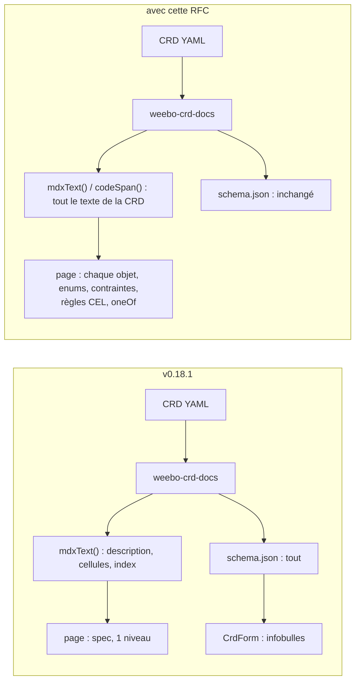
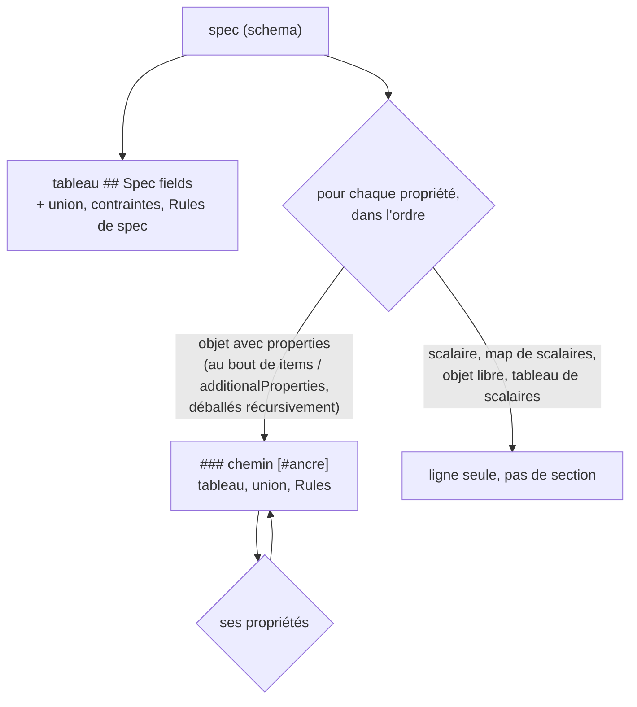
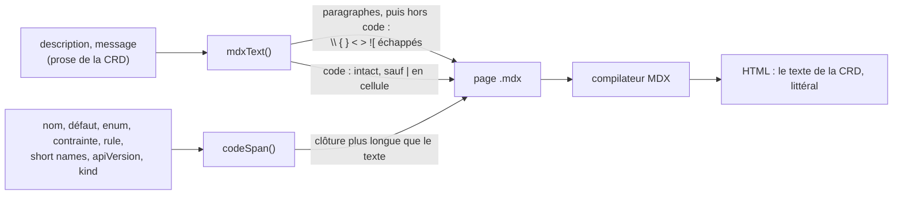

# RFC 0004 — Référence CRD : champs imbriqués et texte sûr pour MDX

| Field       | Value                                                                                  |
| ----------- | -------------------------------------------------------------------------------------- |
| Status      | Accepted (2026-10-19, après grill) ; revue appliquée le 2026-10-19. Phase 1 livrée en **v0.18.1** (`f9b0729`), phase 2 écrite (§17), à publier |
| Short       | Référence CRD complète                                                                 |
| Settles     | Ce que `weebo-crd-docs` écrit sous le tableau des champs de `spec`, et comment il échappe le texte des CRD |
| Author      | Max Batleforc <maxleriche.60@gmail.com>                                                |
| Co-author   | Claude Opus 5.5                                                                        |
| Created     | 2026-10-18                                                                             |
| Supersedes  | —                                                                                      |
| Touches     | `packages/operator-docs/src/crd-docs/generate.mjs`, `packages/operator-docs/bin/weebo-crd-docs.mjs` (sortie du compte), `packages/operator-docs/src/site/docs-page.tsx` (table des matières), `packages/operator-docs/test/`, `packages/operator-docs/package.json` et `package-lock.json` (devDependencies), `packages/operator-docs/README.md` |
| Risk        | medium (§7) : la robustesse du build des sites (un `{` hors code dans une description casse `next build`) et l'intégrité du site publié (XSS) ; pas d'élévation de privilège en CI |

Le format suit le gabarit numéroté des RFC du kit ; *Références* et
*Changelog* sont en fin de document, comme dans les RFC 0001 et 0002.

---

## 1. Summary

`weebo-crd-docs` ne met dans la page d'une kind que les champs de premier
niveau de `spec`. Tout ce qui est plus profond n'existe que dans le formulaire
(`<CrdForm>`), en infobulle. Cette RFC fait écrire au générateur, après le
tableau de `spec`, une section par objet imbriqué : son chemin en titre, son
tableau de champs, ses valeurs d'enum, ses contraintes, ses règles CEL et ses
choix exclusifs (`oneOf`). Tout texte venu d'une CRD passe par une seule
fonction d'échappement avant d'entrer dans le MDX.

La première moitié est livrée : depuis la **v0.18.1**, `mdxText` échappe la
description de `spec`, les cellules du tableau et le résumé de l'index. En
v0.18.0, une accolade ou un `<` hors code dans une de ces descriptions était
lu comme une expression ou un élément MDX. Ce qui reste (§16, phase 2) : les
sections imbriquées, et les trous de l'échappement que la revue a trouvés
(§5.2).

### Before / after

```text
# v0.18.1, content/docs/crds/proxykubeapi.mdx
## Spec fields
| `security_config` | `object` | no |  | Security configuration |
...                                    ← 10 lignes, fin de la référence

# avec cette RFC
## Spec fields
| [`security_config`](#spec.security_config) | `object` | no |  | Security configuration |
...
### `spec.security_config` [#spec.security_config]
| [`allowed_resources`](#spec.security_config.allowed_resources) | `object[]` | no | `[]` | Allowed resources, … |
### `spec.security_config.allowed_resources[]` [#spec.security_config.allowed_resources]
| `path` | `string` | yes |  | … `/apis/\{group\}/\{version\}/…` |
**Rules**
- path must not be empty — `self.path != ''`
...                                    ← une section par objet, jusqu'à la feuille
```



Le schéma JSON et le formulaire ne changent pas. Ce qui change, c'est le texte
de la page, le seul que la recherche et les routes `llms` indexent.

---

## 2. Motivation

1. **La référence s'arrête au premier niveau.** `renderFieldsTable`
   (`src/crd-docs/generate.mjs:125-140`) ne lit que `specSchema.properties`.
   Le tableau ci-dessous compte, dans les CRD de chaque dépôt au 2026-10-19,
   les champs imbriqués qui ont une description et qui n'apparaissent dans
   aucune page :

   | Dépôt | Kinds | Champs | Imbriqués | Imbriqués décrits, absents de la page |
   | --- | --- | --- | --- | --- |
   | ProxyAuthK8S | 1 | 189 | 179 | 138 |
   | weebo-forgejo | 12 | 320 | 209 | 143 |
   | weebo-authentik | 11 | 123 | 66 | 34 |
   | weebo-angos | 4 | 376 | 314 | 199 |
   | weebo-batlehub | 6 | 360 | 323 | 274 |
   | weebo-stalwart | 8 | 127 | 79 | 54 |

   Ces descriptions ne vivent que dans `<CrdForm>`. Le formulaire en montre le
   premier paragraphe sur deux lignes (`line-clamp-2`), et le reste dans
   l'attribut `title` (`src/crd-form/fields.tsx:20-45`). Le formulaire est
   rendu côté client depuis `public/crd-schemas/*.json`. La recherche statique
   (`searchRoute`) et les routes qui portent le texte des pages
   (`llmsFullRoute`, `llmsPageRoute` ; `llmsIndexRoute` ne liste que les
   pages, `src/site/routes.tsx:29-52`) ne voient que le MDX : ces 842
   descriptions sont donc introuvables par la recherche et absentes de ce que
   lit un agent.

2. **Le texte des CRD entrait brut dans le MDX (corrigé en v0.18.1 pour ce
   qui est rendu).** En v0.18.0, `escapeCell` n'échappait que `|` et les
   retours à la ligne, et la description de `spec` était collée telle quelle.
   En MDX, `{…}` est une expression JavaScript et `<x` ouvre un élément JSX.
   Des descriptions en contiennent : 20 dans ProxyAuthK8S (`{{username}}`,
   `/apis/{group}/…`), 23 dans weebo-forgejo, 11 dans weebo-authentik, 16
   dans weebo-angos, 23 dans weebo-batlehub, 13 dans weebo-stalwart. La
   plupart sont dans des spans de code, sans danger ; **hors code**, il en
   reste 8, 4, 2, 5, 15 et 1. Aucune n'est au premier niveau : c'est la seule
   raison pour laquelle les sites construisaient. Le cas le plus répandu est
   le texte de k8s-openapi pour `LabelSelector.matchLabels` (« map of
   {key,value} pairs »), hors code dans cinq opérateurs (angos, authentik,
   batlehub, forgejo, stalwart) : rendre les champs imbriqués sans
   échappement ferait échouer leur `next build` dès la première régénération.

3. **Les contraintes sont invisibles.** Les six dépôts portent 180 règles
   `x-kubernetes-validations` (ProxyAuthK8S 46, weebo-forgejo 33,
   weebo-authentik 4, weebo-angos 25, weebo-batlehub 61, weebo-stalwart 11),
   117 enums, 10 unions `oneOf`, et des contraintes de schéma : 32 `pattern`,
   89 `minimum`, 10 `maximum`, 41 `minLength`, 56 `maxLength`, 14 `minItems`
   et 44 `maxItems` (`status` compris). Aucune n'atteint la page. Un
   utilisateur découvre la règle au `kubectl apply`, par le message de
   l'apiserver.

4. **Un opérateur qui adopte le kit perd sa référence.** ProxyAuthK8S
   (RFC 0005 de ce dépôt-là, phase 3) remplace une page crdoc de 53 sections,
   une par objet de `ProxyKubeApi.spec`, par la page du kit. Sur un proxy de
   sécurité, `security_config` (règles d'accès, exec, port-forward) est
   justement ce qu'on vient lire. L'adoption est en attente de cette RFC.

5. **Les paragraphes sont aplatis.** Dans une cellule, `mdxText` remplace
   chaque retour à la ligne par une espace, saut de paragraphe compris. Une
   description en deux paragraphes (« Kept as a real field rather than a serde
   alias on purpose: … ») devient une seule phrase sans respiration.

---

## 3. Goals / non-goals

**Goals**

- Chaque champ de `spec` qui a une description, à n'importe quelle
  profondeur, apparaît en texte sur la page de sa kind.
- Le texte d'une CRD est rendu comme du **Markdown inline, sans JSX, sans
  expression et sans image** : `*`, `` ` `` et les liens `[x](…)` gardent leur
  sens Markdown (les descriptions sont écrites ainsi dans le Rust), mais aucun
  caractère ne peut devenir une expression, un élément ou une image.
- Les valeurs d'enum, les défauts, les contraintes de schéma, les règles CEL
  (message et règle) et les choix exclusifs (`oneOf`/`anyOf` de `required`)
  sont écrits sur la page.
- Chaque objet a une ancre stable, dérivée de son chemin, liée depuis la ligne
  de son parent, et listée dans la table des matières.
- Les sauts de paragraphe d'une description survivent dans une cellule.

**Non-goals**

- **Le support des enums serde externes (`oneOf` de `required`) dans
  `<CrdForm>`.** C'est un autre composant, avec un autre coût. La page les
  décrit ; le formulaire reste tel quel.
- **Le schéma `status`.** Ce que l'opérateur écrit n'est pas ce que
  l'utilisateur déclare. On peut le faire plus tard, avec la même fonction.
- **Plusieurs versions par CRD.** Toutes les CRD actuelles n'en ont qu'une.
  `versions[0]` (`:213`) reste, cf. *Deliberately untouched*.
- **Des sections repliables (`Accordion`).** Le contenu replié échappe au
  Ctrl-F du navigateur. Une page longue, avec une table des matières, se lit
  mieux.
- **Rendre obligatoires les descriptions des champs.** Un champ sans
  description reste une ligne avec une cellule vide, comme aujourd'hui.
  En faire une erreur bloquerait les opérateurs pour une question de rédaction.
- **Changer le schéma JSON publié ou `index.json`.** `<CrdForm>` et
  `<CrdBuilder>` les lisent ; ils ne bougent pas.

---

## 4. User-facing design

### 4.1 Configuration

Aucune option nouvelle dans `crd-docs.config.mjs`. Le rendu complet est le
comportement par défaut, et il n'y a pas de drapeau pour revenir au premier
niveau seul : une référence tronquée n'est pas un réglage. Un opérateur qui
monte de version régénère ses pages (`task recu`, `npm run gen:crds`) et
relit le diff.

### 4.2 Behaviour rules

**Ordre et chemins.**

- La page garde son ordre : faits, description, exemple, `## Spec fields`
  (tableau de `spec`, puis ses unions, contraintes et règles), puis les
  sections imbriquées, puis `## Build a manifest` et `<CrdForm>`.
- Les sections suivent un parcours en profondeur, dans l'ordre de déclaration
  des propriétés. C'est l'ordre des champs Rust, celui de crdoc.
- Un objet reçoit une section s'il a des `properties`. Le parcours déballe
  `items` et `additionalProperties` **récursivement** : un tableau de
  tableaux d'objets (`spec.a[][]`), une map de tableaux d'objets
  (`spec.a[key][]`) reçoivent la section de l'objet qu'ils contiennent.
  ProxyAuthK8S a quatre `exec.commands` en `string[][]` : sans objet au bout,
  ils restent une ligne.
- Le chemin s'écrit `spec.a.b`. Un tableau s'écrit `spec.a[]` et une map
  `spec.a[key]`. L'ancre est le chemin sans `[]` ni `[key]` (`spec.a.b`),
  posée avec la syntaxe d'ancre de Fumadocs (`### titre [#id]`, option
  `customId` de `remarkHeading`, active par défaut ; fumadocs-core n'exporte
  pas de `headingIdRegex`). Elle ne dépend donc pas du slugger.
- **Jeu de caractères des ancres** : `[A-Za-z0-9_.-]`. La regex de
  `remarkHeading` (`/\s*\[#(?<slug>[^]+?)]\s*$/`) s'arrête au premier `]`, et
  un espace ou une parenthèse casserait la destination du lien `(#…)`. Un nom
  de propriété hors de ce jeu fait échouer la génération, avec la même erreur
  qu'une ancre en double (§4.3).
- Une profondeur sans section : un objet sans `properties`
  (`x-kubernetes-preserve-unknown-fields`, map de scalaires) reste une ligne,
  sans section.

**Cellules.**

- **Nom** : le nom du champ par `codeSpan`, avec un lien vers sa section quand
  il en a une.
- **Type** : `fieldType`. Les maps s'écrivent `map[<type de la valeur>]`
  (`map[string]`, `map[object]`, `map[string[]]`), les tableaux `<type>[]`.
  Un champ `x-kubernetes-int-or-string: true` (sans `type` dans le schéma ; 12
  dans les six dépôts) s'écrit `int-or-string` ; v0.18.1 l'affiche `object`.
- **Required** : `yes` ou `no`. Pour un champ d'une union de plusieurs
  branches, `one of` (`oneOf`) ou `any of` (`anyOf`). Une union d'une seule
  branche (`oneOf: [{required: [Secret]}]`, ProxyAuthK8S
  `deploy/crds.yaml:337-339`) n'est pas un choix : son champ est simplement
  `yes`.
- **Default** : `codeSpan(JSON.stringify(default))`.
- **Description** : le texte échappé (`mdxText`), puis, sur la même cellule,
  les fragments :
  - `Values:` et chaque valeur de l'enum en `codeSpan(JSON.stringify(v))` ;
    la valeur `null` (que produit un `Option<enum>` ; 15 dans les dépôts,
    `spec.authentication` et `spec.deniedAction` chez authentik, `pullPolicy`
    chez angos et batlehub) est retirée de la liste : le champ est déjà
    marqué `no` ;
  - `Constraints:` et les bornes présentes, en code : `pattern`,
    `minimum`/`maximum` (et `exclusive*`), `minLength`/`maxLength`,
    `minItems`/`maxItems`. Un `pattern` (`{`, `|`, `<`) passe par
    `codeSpan`, et sert lui aussi de test de l'échappement.
- Un saut de paragraphe devient `<br /><br />` ; un simple retour à la ligne
  devient une espace, comme en Markdown.

**Ce qui suit le tableau d'une section** (et celui de `## Spec fields` pour
`spec` lui-même).

- Quand l'objet est une union de plusieurs branches dont chacune n'est qu'un
  `required` d'un seul champ, une ligne « Exactly one of `ConfigMap`,
  `Secret`, … » (`oneOf`) ou « At least one of … » (`anyOf`). C'est cette
  ligne, sous le tableau de la section de l'objet, qui porte l'union : la
  ligne du champ parent ne fait que lier la section. Une autre forme de
  `oneOf` est écrite « Matches one of N shapes; see the schema », sans essayer
  de la décrire.
- Quand l'objet a des `x-kubernetes-validations`, une liste **Rules** : le
  `message`, puis la `rule` en `codeSpan`, puis le `fieldPath` en code quand
  il y en a un. Une règle sans `message` montre la règle seule.

**Ce qui change sur une kind sans objet imbriqué.** Pas de section, pas de
liste vide, pas de titre orphelin. Mais la page n'est pas celle de la
v0.18.1 octet pour octet : le type d'une map (`object` → `map[string]`), un
enum (`Values:`), une contrainte, une règle sur `spec` ou un `int-or-string`
changent sa ligne. Le diff se relit dans la PR de `kit:sync` (§13).

**Le texte.** Deux fonctions voient tout ce qui vient d'une CRD :

- **`mdxText(text, { cell })`** pour la prose : description de `spec`,
  descriptions des champs, messages de règles, résumé de l'index. Livrée en
  v0.18.1 (`generate.mjs:94-123`). Elle découpe le texte en spans de code
  (séquences de backticks appariées, CommonMark) :
  - **hors code**, elle échappe `\`, `{`, `}`, `<` et `>` par une barre
    oblique inverse, et (phase 2) le `!` d'un `![` ;
  - **dans le code**, elle ne touche à rien : MDX n'y lit ni expression ni
    JSX, et un `\{` y serait affiché tel quel ;
  - une séquence de backticks **orpheline** est du texte, jamais le début
    d'un span ;
  - **avec `cell`**, elle échappe en plus `|` partout, code compris (GFM coupe
    la cellule même dans un span de code), et applique la règle des
    paragraphes.

  **Phase 2 : paragraphes d'abord, code ensuite.** Le texte est découpé en
  paragraphes (lignes vides) **avant** la recherche des spans de code : en
  CommonMark, une ligne vide termine le paragraphe, donc aucun span de code ne
  la traverse. Une clôture de backticks sans partenaire dans son paragraphe
  est du texte. Sans cette règle, la description `Quantity` de k8s-openapi
  (2,4 Ko, un bloc ` ``` ` qui enjambe des lignes vides, avec `|` et `<…>` ;
  `weebo-batlehub/deploy/crd/batlehublocalinstance.yaml:1077`, `:1086`) serait
  lue comme un seul span de code, et le `<br /><br />` des paragraphes
  atterrirait dedans, affiché littéralement. Avec elle, les ` ``` ` orphelins
  sont du texte, et les `<quantity>` hors code sont échappés.

- **`codeSpan(text)`** pour ce qui est **montré comme du code** : nom de
  champ, défaut, valeurs d'enum, contraintes, règle CEL, `fieldPath`, short
  names, `apiVersion` et `kind` (faits de la page et lignes de l'index). Elle
  choisit une clôture de backticks plus longue que la plus longue séquence du
  texte, ajoute une espace de chaque côté si le texte commence ou finit par un
  backtick, et échappe `|` en cellule. Le contenu d'un span de code n'est lu
  ni comme expression ni comme JSX : rien d'autre à échapper.

`kind` et `singular` sont aussi validés contre `^[A-Za-z][A-Za-z0-9]*$` et
`^[a-z0-9]([-a-z0-9]*[a-z0-9])?$` (l'apiserver le fait déjà ; le générateur le
refait parce qu'il lit des fichiers, pas l'apiserver) : `singular` nomme le
fichier écrit, `kind` entre dans un lien et dans `<CrdForm kind="…">`.

### 4.3 Validation

Bloquant, au moment de la génération :

| Condition | Rationale |
| --- | --- |
| Inchangé : exemple manquant, champ inconnu, `required` absent (`checkExample`, `:158-168`) | l'exemple reste vérifié contre le schéma |
| Deux sections produiraient la même ancre (un champ nommé `a.b` à côté d'un objet `a` qui a un champ `b`) | un lien mènerait au mauvais objet sans que personne le voie |
| Un nom de propriété hors de `[A-Za-z0-9_.-]`, un `kind` ou un `singular` hors de leur forme (§4.2) | l'ancre, le lien ou le nom de fichier serait faux |

Avertissements :

| Condition | Behaviour | Surfaced in |
| --- | --- | --- |
| Champs sans description | comptés par kind, la page est écrite quand même | une ligne par kind concernée (`ForgejoRepository: 3 fields without a description`), écrite par le générateur lui-même (`console.warn`) et lue dans la sortie de `task recu` |

---

## 5. Architecture

### 5.1 Le parcours



Un schéma structurel Kubernetes ne peut pas être récursif (l'apiserver refuse
`$ref`) : le parcours termine toujours, et il n'a pas besoin de limite de
profondeur. Les CRD actuelles descendent jusqu'à 8 niveaux de propriétés
(weebo-batlehub), 6 pour ProxyAuthK8S et weebo-angos ; ProxyKubeApi produit
53 sections.

### 5.2 Le texte



**Invariant** : la construction de la page ne concatène aucun texte venu
d'une CRD sans passer par `mdxText` ou `codeSpan`. Le texte d'une CRD ne peut
donc jamais devenir une expression, un élément ni une image. Le test `crd text
never reaches MDX as code` (§14) compile et évalue chaque page générée à partir
d'une fixture hostile, et le vérifie.

**État en v0.18.1.** L'invariant tient pour la prose : description de `spec`,
description des champs, résumé de l'index. Il ne tient pas encore pour ce qui
est entouré de backticks fixes et passé ensuite à `mdxText` : le nom du champ
et le défaut (`generate.mjs:130-134`), les short names (`codeList`, `:170`,
rendus `:235` et `:272`), `apiVersion` (`:233`) et `kind` dans le lien de
l'index (`:272`). Un backtick dans un défaut (ou dans une valeur d'enum, une
fois rendue) ferme le span, et la suite redevient du MDX : T1 et T2 s'y
rouvrent. La phase 2 les fait passer par `codeSpan` et ajoute à la fixture
hostile un défaut qui contient `` ` `` et `{`, une valeur d'enum avec `|`, un
nom de propriété avec un backtick (refusé par §4.3), et un short name avec un
backtick.

**Ce que l'échappement laisse au Markdown.** Le goal 2 garde le Markdown
inline : `*`, `_`, `[x](…)`, `&amp;` restent interprétés. Une image, non :
`remarkImage` est actif par défaut dans fumadocs-mdx (preset,
`remark-include-*.js:28`) avec `external: true` et `onError: "error"`
(`fumadocs-core/dist/mdx-plugins/remark-image.js:16`) : un ``
dans un commentaire Rust ferait une requête réseau au build, un échec du
build si l'hôte ne répond pas, et un pixel de suivi sur le site publié.
`mdxText` échappe donc le `!` d'un `![` hors code (phase 2).

---

## 6. Detailed design

### 6.1 `src/crd-docs/generate.mjs`

- `mdxText(text, { cell = false } = {})` (v0.18.1, exportée pour le test)
  gagne le découpage en paragraphes avant les spans de code, la règle des
  paragraphes en cellule et l'échappement de `![`.
- `codeSpan(text, { cell = false } = {})` : clôture plus longue que la plus
  longue séquence de backticks du texte, espaces de garde, `|` échappé en
  cellule. Exportée pour le test.
- `fieldType(schema)` gagne `map[…]` (`additionalProperties`, récursif),
  `<type>[]` récursif (`string[][]`) et `int-or-string`
  (`x-kubernetes-int-or-string`).
- `renderFieldsTable(schema, path, anchors)` lit `schema.properties`,
  `schema.required` et `schema.oneOf`/`anyOf`. Il lie le nom quand le champ a
  une section, et ajoute `Values:` et `Constraints:`.
- `renderSections(schema, path)` est récursif. Il renvoie le Markdown des
  sections de tous les descendants : titre, tableau, ligne d'union, `Rules`.
- `renderRules(schema)` construit la liste à partir de
  `x-kubernetes-validations` (`message`, `rule`, `fieldPath`).
- Les faits de la page (`:233-235`) et les lignes de l'index (`:270-274`)
  passent `apiVersion`, `kind` et les short names par `codeSpan`.
- Le résumé du frontmatter reste dans `yaml.dump` (`:243`), qui échappe déjà
  pour YAML : le frontmatter n'est pas lu comme du MDX.
- Le compte des champs sans description est écrit par le générateur
  (`console.warn`, une ligne par kind). `generateCrdDocs` garde sa valeur de
  retour (le nombre de CRD) : aucun opérateur ne l'appelle directement — tous
  passent par `bin/weebo-crd-docs.mjs` et n'importent que `defineConfig`.
  Aucun changement cassant, ni pour le binaire ni pour l'export
  `./crd-docs`.

### 6.2 `src/site/docs-page.tsx`

Le générateur écrit `full: true` dans le frontmatter (`generate.mjs:243`),
pour que le formulaire ait toute la largeur, et `docs-page.tsx:61` le
transmet à `DocsPage`. Or, dans fumadocs-ui, `full` coupe la table des
matières latérale (`layouts/docs/page/index.js:34`, `tocEnabled = !full`) ; il
ne reste que le popover, masqué au-dessus du breakpoint `xl`
(`slots/toc.js:81`). Sur grand écran, une page de 53 sections n'aurait aucune
table des matières, ce que le non-goal *Accordion* et §11 *Accessibility*
supposent.

`DocsPage` reçoit donc `tableOfContent={{ enabled: true }}` quand
`page.data.full` est vrai : la page garde sa largeur, et la table latérale
revient. La preuve §6.P point 2 vérifie qu'à 1440 px le formulaire tient
toujours dans la colonne. Si ce n'est pas le cas, le générateur cesse
d'écrire `full: true` sur les pages qui ont des sections.

### 6.3 `test/`

- La fixture hostile de la v0.18.1 (`fixtures/crd-hostile/hostile.yaml`)
  gagne : un défaut qui contient `` ` `` et `{`, une valeur d'enum avec `|`
  et une avec un backtick, un `pattern` avec `{`, `|` et `<`, un short name
  avec un backtick, un `` hors code, et la
  description `Quantity` de k8s-openapi telle quelle (bloc ` ``` ` sur
  plusieurs paragraphes).
- `fixtures/crd/` gagne une kind `ExampleNested` : un objet, un tableau
  d'objets, un tableau de tableaux d'objets, une map d'objets, une map de
  scalaires, un `int-or-string`, un enum avec `null`, des contraintes, un
  `oneOf` de `required` à plusieurs branches, un `oneOf` d'une seule branche,
  un `oneOf` d'une autre forme, des règles CEL (avec et sans message, avec
  `fieldPath`, une règle qui contient un backtick) et deux paragraphes.
- **Le harnais compile comme le site.** `@mdx-js/mdx` et `remark-gfm` sont des
  devDependencies depuis la v0.18.1. La phase 2 ajoute aux `remarkPlugins`
  `remarkHeading` (de `fumadocs-core/mdx-plugins`), sans lequel la syntaxe
  `[#id]` n'est pas lue, et rend la page avec `react-dom/server`
  (`renderToStaticMarkup`), avec un `CrdForm` factice. Sans `remark-gfm`,
  `@mdx-js/mdx` ne reconnaît pas les tableaux (la sortie est un paragraphe) :
  le test de T3 ne prouverait rien. C'est le preset de fumadocs-mdx
  (`remark-include-*.js:23-24`), moins `remarkImage`, que le test remplace par
  l'assertion qu'aucun `` devient `-\>` dans `AuthentikGroup.parentRef`), au rendu identique.
   Les deux sites se construisent (weebo-forgejo v0.5.0, weebo-authentik
   v0.19.0). ProxyAuthK8S n'en dépend pas encore (voir plus bas).

Consommateurs : deux sites réels, construits avec Next 16.4 en export statique
comme sur GitHub Pages. weebo-forgejo, en npm, est le plus gros des sites
adoptés (12 kinds). ProxyAuthK8S, en pnpm, a l'unique CRD la plus profonde ;
son `docs/package.json` ne dépend pas encore de `@weebo/operator-docs`, la
preuve s'y fait donc sur la branche de sa phase 3 (RFC 0005 de ce dépôt). En
npm, le paquet local s'installe par `file:` avec `npm install --install-links`
(README, *Installing*) ; en pnpm, par `pnpm add file:<tgz>` sur la tarball de
`task docs:pack`. Puis sur la tarball de la release.

1. `npm run gen:crds` puis `next build` dans `weebo-forgejo/docs` :
   code 0, et le compte de champs sans description s'affiche. Temps de build
   mesuré avant et après (§10.3).
2. `out/docs/crds/forgejorepository/index.html` contient une section
   `id="spec.fromTemplate"`, la ligne `fromTemplate` du tableau de `spec`
   la lie (`href="#spec.fromTemplate"`), et la table des matières latérale
   est présente à 1440 px, formulaire compris dans la colonne (§6.2).
3. Même chose dans ProxyAuthK8S :
   - `out/docs/crds/proxykubeapi/index.html` contient la section
     `spec.security_config.allowed_resources` ;
   - le texte `/apis/{group}/{version}/namespaces/{namespace}/` y apparaît
     littéralement (les accolades sont dans le HTML, pas de `\`) ;
   - la section `spec.cert` porte, sous son tableau, `Exactly one of` avec
     ses cinq variantes (`deploy/crds.yaml:424-436`).
4. La recherche : l'index statique (`out/api/search`) contient un mot qui
   n'existe que dans une description imbriquée (`allowed_ressources`,
   « Deprecated misspelling »), absent de l'index construit avec la page du
   kit v0.18.1 (la page crdoc actuelle de ProxyAuthK8S le contient, elle).
   Sa taille avant et après est relevée (§10.3).
5. `out/llms-full.txt` contient la règle CEL
   `!has(self.dashboard_group) || self.dashboard_group != ''` et son message.
   Le texte y est resérialisé par `mdast-util-to-markdown` avec
   `mdxToMarkdown` : hors code, les échappements réapparaissent
   (`/apis/\{group}/\<v>`). La règle est dans un span de code d'une liste, et
   y reste intacte.
6. **Refus : du code dans une description** (fait en v0.18.1). Une
   description de premier niveau est remplacée par
   `{globalThis.process.getBuiltinModule('node:fs').writeFileSync('/tmp/pwned', '1')}`
   (`require` n'existe pas dans le MDX évalué : `ReferenceError`). Après
   `gen:crds` et `next build`, `/tmp/pwned` n'existe pas, et la page montre ce
   texte tel quel. Contrôle : le même texte, non échappé, écrit le fichier
   (§7, T1). La fixture hostile et le test du kit font la même chose.
7. **Refus : un élément dans une description** (fait en v0.18.1).
   `<script>alert(1)</script>` dans une description apparaît sous forme
   `&lt;script&gt;` dans le HTML exporté. Aucune balise `<script>` ne vient
   du texte de la CRD (§7, T2). En phase 2, la même chose dans une
   description imbriquée, et un `` qui ne
   produit ni ``, `` ou une image Markdown dans une description devient un élément rendu sur le site publié, après merge | 2 → 5 | `mdxText` échappe `<`, `>` et `![` hors code ; `codeSpan` ; React échappe le texte ; §6.P point 7 | aucun |
| T3 | Tampering : un `|` ou un saut de ligne dans une description casse le tableau et décale les colonnes (un « yes » qui devient « no » dans Required) | 2 | `mdxText({ cell: true })` et `codeSpan({ cell: true })` échappent `|` partout et réécrivent les sauts de ligne ; test sur la fixture `a | b`, harnais avec `remark-gfm` | aucun |
| T4 | Spoofing : un champ nommé `a.b` prend l'ancre de l'objet `a.b`, ou un nom avec `]` casse l'ancre, et le lien du parent mène à la mauvaise section | 2 | refus d'une ancre en double et des noms hors de `[A-Za-z0-9_.-]` (§4.3) ; §6.P point 8 | aucun |
| T5 | DoS : une CRD énorme produit une page qui ne se construit pas | 2 → 3 | la taille de la page est linéaire en nombre de champs, et l'apiserver borne déjà la taille d'une CRD ; budget §10.3 | aucun |
| T6 | Information disclosure : une image Markdown fait une requête au build (`remarkImage`, `external: true`) et pose un pixel de suivi chez les visiteurs | 2 → 3, 5 | `![` échappé hors code (phase 2) ; fixture | aucun |

En v0.18.0, T1 et T2 étaient ouverts sur la description de `spec` et sur les
champs de premier niveau ; la v0.18.1 les a fermés pour la prose. Restent
ouverts jusqu'à la phase 2 : les défauts, les noms, les short names,
`apiVersion` et `kind` (§5.2), et les images (T6).

### 7.2 Authentication and authorisation

Pas de nouvelle surface : un générateur hors ligne, lancé par le développeur
ou par la CI, sur des fichiers du dépôt. Le site publié est statique et
public, comme aujourd'hui.

### 7.3 Input handling and injection

- L'entrée est la CRD YAML du dépôt (js-yaml, `yaml.load`, schéma par défaut :
  pas de types JavaScript).
- La sortie est du MDX. L'échappement est contextuel (prose : hors code, code,
  cellule ; code : `codeSpan`), dans deux fonctions (§4.2) testées sur une
  fixture hostile.
- Les chemins de fichiers écrits ne changent pas : `<singular>.mdx` et
  `<singular>.schema.json`, avec `singular` revalidé (§4.2).
- Aucune taille d'entrée n'est nouvelle.

### 7.4 Secrets and cryptography

Sans objet : ni secret ni cryptographie. Une CRD ne contient pas de secret, et
le générateur n'en lit pas.

### 7.5 Abuse and resource exhaustion

Le parcours termine (§5.1, un schéma structurel n'est pas récursif). La taille
de la page est proportionnelle au nombre de champs : estimée sous 150 Ko pour
la plus grosse kind actuelle. Elle est mesurée au point 1 de §6.P.

### 7.6 Existing defences that still hold

- `checkExample` refuse toujours un exemple qui ne correspond pas au schéma.
- `stripK8sExtensions` continue de retirer les extensions du schéma publié.
- `yaml.dump` échappe le frontmatter.

---

## 8. Supply chain

| Dependency / image / tool | Version | Why this one | Licence | Known CVEs | Maintenance |
| --- | --- | --- | --- | --- | --- |
| `@mdx-js/mdx` (devDependency, test seulement, depuis v0.18.1) | 3.1.1, celle que `fumadocs-mdx` 15.4.6 installe déjà ; à épingler en `3.1.1` comme les autres devDependencies `fumadocs-*` (v0.18.1 l'a ajoutée en `^3.1.1`) | le test doit compiler les pages avec le compilateur réel, pas une regex | MIT | aucune connue (`npm audit` complet, à la main) | projet unified |
| `remark-gfm` (devDependency, test seulement, depuis v0.18.1) | 4.0.1, aussi installée par `fumadocs-mdx` ; même épinglage | les tableaux GFM du site, pour compter les colonnes (T3) | MIT | aucune connue (idem) | projet unified |

- **Audit** : `task audit` lance `npm audit --omit=dev` (`tasks/repo.yaml:35`)
  et `task docs:check` lance `npm ci --no-audit` (`Taskfile.yaml:163`) : une
  devDependency n'est auditée par aucune tâche. Ces deux paquets ne sont pas
  publiés et ne tournent qu'en test ; un `npm audit` complet est relancé à la
  main à chaque changement de leur version.
- **Build and release** : la tarball ne change pas de forme (`files` de
  `package.json` inchangé). Les devDependencies ne sont pas publiées.
- **Updates** : le kit n'a pas de configuration Dependabot (`.github/` ne
  contient que `actions/` et `workflows/`). Les versions suivent celle de
  `fumadocs-mdx`, montée à la main avec les autres `fumadocs-*`.

---

## 9. Data and privacy

| Data | Personal? | Where stored | Retention | Who can read it | Leaves the instance? |
| --- | --- | --- | --- | --- | --- |
| Descriptions, règles, contraintes et enums des CRD, désormais rendus en texte | non : du texte de schéma écrit par les mainteneurs | `content/docs/crds/*.mdx`, site publié | celle du dépôt | public, comme le schéma JSON déjà publié | déjà publiées dans `public/crd-schemas/*.json` |

Aucune donnée nouvelle : la page montre ce que le schéma JSON publié contient
déjà. Aucune requête sortante non plus : les images d'une description ne sont
plus résolues (T6).

---

## 10. Operability

### 10.1 Observability

- **Metrics** : aucune, le générateur ne tourne pas en production.
- **Logs** : une ligne par kind, avec le compte des champs sans description
  (§4.3).
- **Alerts** : aucune, parce qu'il n'y a rien qui tourne.

### 10.2 Failure modes

| Failure | Detected by | Behaviour (fail open / closed) | Recovery |
| --- | --- | --- | --- |
| Ancre en double, nom de propriété hors jeu | le générateur | fermé : erreur, aucune page écrite | renommer le champ |
| Forme de schéma inconnue (`oneOf` non `required`, `allOf`) | rien à détecter | ouvert, volontairement : une ligne générique « Matches one of N shapes » plutôt qu'une erreur ; la page reste correcte, juste moins précise | une PR kit pour la forme |
| MDX invalide malgré l'échappement | le test du kit, puis `next build` de l'opérateur | fermé : le build échoue | corriger `mdxText` ou `codeSpan` |
| Pages générées non commitées après un `kit:sync` | `regen-and-diff` de la CI de l'opérateur (`weebo-forgejo/.github/workflows/ci.yml:66-84`) | fermé : la PR échoue | `task recu`, commit des pages |

### 10.3 Performance and capacity

La génération reste sous la seconde : quelques milliers de champs, sans I/O
par champ. Mesuré au point 1 de §6.P, avant et après, sur weebo-forgejo et
ProxyAuthK8S :

- **build Next** : +20 % de temps au plus ;
- **index de recherche** : `remark-structure` indexe chaque cellule de tableau
  (`remark-structure.js:9-14`), « no » et « object » compris, et l'index
  statique `/api/search` est téléchargé par le navigateur. Sa taille est
  relevée avant et après ; budget : +100 % au plus pour weebo-forgejo. Les
  entrées sont rattachées à leur section : la recherche mène directement à
  `#spec.a.b`.

Au-delà d'un budget, retour à la RFC avant la release (§15, décision 10).

---

## 11. Other concerns

- **Accessibility** : les sections sont des titres `###` dans l'ordre, que la
  table des matières latérale liste (§6.2), les tableaux restent des
  tableaux, et les liens ont pour texte le nom du champ.
- **Internationalisation** : le texte fixe du générateur est en anglais, comme
  aujourd'hui (« Spec fields », « Rules », « Constraints », « Exactly one
  of »). Les descriptions sont dans la langue du Rust.
- **Compliance** : sans objet.
- **Licensing** : inchangé (MIT).
- **Documentation** : le README du paquet (§6.4). Le CHANGELOG est généré par
  cog à partir des commits (`fix` en v0.18.1, `feat` pour la phase 2).

---

## 12. Alternatives considered

| Alternative | Why rejected |
| --- | --- |
| Ne rien faire | la motivation 4 bloque une adoption, et rendre un jour les champs imbriqués casserait cinq builds (`LabelSelector`) |
| crdoc dans chaque opérateur, à côté de la page du kit | ProxyAuthK8S l'a fait : un binaire Go, un `perl` pour échapper les accolades, `add-frontmatter.sh`, et deux références qui divergent ; le kit existe pour ne pas recopier ça six fois |
| Une page par objet imbriqué | 53 pages pour ProxyKubeApi dans la barre latérale, et la référence d'un champ ne tient plus sur une page qu'on parcourt |
| Rendre les descriptions dans `<CrdForm>` en entier | le texte resterait hors de la recherche et des routes `llms` (motivation 1), et le formulaire deviendrait une référence illisible |
| Échapper avec une regex unique, sans distinguer le code | `\{` dans un span de code s'affiche avec sa barre oblique : `{{username}}` en code deviendrait faux ; c'est le bug que le `perl` de ProxyAuthK8S contournait déjà |
| Écrire les pages en `.md` (pas d'expressions en Markdown pur) | la page porte `<CrdForm>`, qui exige du MDX |
| Retirer `full: true` des pages CRD | le formulaire perd la largeur dont il a besoin ; `tableOfContent.enabled` garde les deux (§6.2) |
| Les contraintes de schéma en non-goal | elles sont dans le même nœud que l'enum, un fragment de cellule suffit, et un `pattern` est justement ce qu'un utilisateur cherche avant le `kubectl apply` |
| Les descriptions longues ou multi-paragraphes sous le tableau plutôt que dans la cellule | une ligne de tableau qui renvoie ailleurs pour sa propre description se lit mal ; `<br /><br />` en cellule suffit (§15, décision 3) |

---

## 13. Rollout and compatibility

- **Default behaviour** : à la prochaine régénération, chaque page gagne ses
  sections. Les URLs existantes ne bougent pas, et les nouvelles ancres
  s'ajoutent.
- **Migration** : `kit:sync TAG=vX.Y.Z`, puis `task recu` (ou
  `npm run gen:crds`) dans chaque opérateur, et **les pages régénérées dans la
  même PR** : elles sont commitées, et le job `regen-and-diff` de la CI des
  opérateurs échoue sinon. Le diff des pages se relit dans la PR. Réversible :
  le tag précédent régénère les pages d'avant.
- **Operator prerequisites** : aucun. ProxyAuthK8S doit d'abord dépendre de
  `@weebo/operator-docs` (sa phase 3), en pnpm.
- **Rollback** : revenir au tag précédent. Revenir avant la v0.18.1 rouvre
  T1/T2 sur le premier niveau.
- **Version** : deux releases. La **v0.18.1** (patch, `fix`) contient
  l'échappement de la prose ; elle est publiée et synchronisée dans
  weebo-forgejo (v0.5.0) et weebo-authentik (v0.19.0). La phase 2 (`feat`,
  sans changement cassant) est une mineure : **v0.19.0**, sauf si une autre
  mineure du kit sort avant, auquel cas elle prend le numéro suivant.
  ProxyAuthK8S vise directement la release de la phase 2.

---

## 14. Test plan

- **Unit** (`test/crd-docs.test.mjs`) :
  - `mdxText` : hors code, code, cellule, backticks appariés et orphelins,
    barre oblique inverse (fait en v0.18.1) ; deux paragraphes, bloc
    ` ``` ` qui enjambe des paragraphes, `![` (phase 2) ;
  - `codeSpan` : un texte qui contient un backtick, qui commence ou finit par
    un backtick, un `|` en cellule ;
  - `fieldType` : maps, tableaux de tableaux, `int-or-string`.
- **Integration** (même fichier) : la fixture `ExampleNested` produit, pour
  chaque objet, une section avec son ancre et son lien ; `Values:` sans
  `null` ; `Constraints:` ; `Exactly one of` sous la section de l'union ;
  `yes` pour l'union d'une seule branche ; `Rules` avec `fieldPath` ; et, pour
  la kind qui n'a que des scalaires (`ExampleGadget`), aucune section.
- **Proof** : §6.P.
- **Security** :
  - T1, T2, T6 : `crd text never reaches MDX as code` (v0.18.1, étendu en
    phase 2). Chaque page générée est compilée et évaluée avec `@mdx-js/mdx`,
    `remark-gfm` et `remarkHeading`, rendue avec un `CrdForm` factice, sans
    erreur. Le rendu contient `{{username}}` et `<script>` en texte. Aucun
    élément `script` ni `img` n'est produit, et un `{…}` qui écrirait un
    fichier (`globalThis.process.getBuiltinModule('node:fs')`) n'écrit rien ;
    le contrôle non échappé, lui, l'écrit.
  - T3 : `a | b` et une valeur d'enum avec `|` restent dans leur cellule
    (nombre de colonnes constant).
  - T4 : `duplicate anchors are refused`, `anchor charset is enforced`.
- **Audit** : `npm audit` complet du paquet, à la main (§8).
- **Existing suites** : `task docs:check` (tsc contre les planchers des peers,
  tests du générateur et de la référence) inchangé en résultat.

---

## 15. Decisions and open questions

### Resolved

| # | Question | Decision |
| --- | --- | --- |
| 1 | Forme de l'ancre | **Le chemin avec ses points** (`#spec.security_config`), dans le jeu `[A-Za-z0-9_.-]`. Vérifié : la table des matières cherche les titres par `document.getElementById` (`fumadocs-core/dist/toc.js:172`, `:202`), sans sélecteur CSS, et `remarkHeading` accepte tout caractère sauf un `]` final. |
| 2 | Règles CEL | **`message`, `rule` en code, et `fieldPath` s'il existe.** Le message seul ment parfois par omission. Vérifié : toutes les règles des six dépôts ont un `message`, aucune n'a de `messageExpression`, 45 ont une `reason` (non affichée : c'est le code HTTP de l'apiserver) et une a un `fieldPath`. |
| 3 | Paragraphes dans une cellule | **`<br /><br />` pour un paragraphe, une espace pour un simple retour à la ligne** (règle Markdown). Vérifié : dans une cellule GFM compilée par MDX, il donne `<br/><br/>` ; les deux balises apparaissent aussi dans `llms-full.txt`. |
| 4 | Champs sans description | **Comptés, sans bloquer**, par le générateur. Aucun opérateur ne consomme la valeur de retour de `generateCrdDocs`. |
| 5 | Release | **Deux releases dédiées**, voir 6 et §13. La phase 2 est une mineure de toute façon : la sortie des pages change, et le précédent `feat!` (08b2208) a donné la v0.18.0. |
| 6 | Correctif et fonctionnalité ensemble ? | **Séparés.** L'échappement est sorti seul en v0.18.1, avant la partie longue. |
| 7 | Markdown des descriptions | **Markdown inline gardé, sans JSX, sans expression et sans image** : échappement de `\ { } < >` et `![` hors code, plutôt qu'un rendu en texte brut qui afficherait les backticks. |
| 8 | Forme de schéma inconnue | **Ligne générique, sans erreur** (§10.2). |
| 9 | Hors périmètre | **Confirmé** : schéma `status`, versions multiples, `oneOf` serde dans `<CrdForm>`. |
| 10 | Budget et preuve | **weebo-forgejo et ProxyAuthK8S, +20 % de temps de build et +100 % d'index de recherche au plus** (§10.3) ; au-delà, retour à la RFC avant la release. |
| 11 | Valeur de retour de `generateCrdDocs` | **Inchangée** ; le compte passe par `console.warn`. Pas de `feat!`. |
| 12 | Contenu de la v0.18.1 | **`mdxText` sur la prose déjà rendue** (description de `spec`, cellules, index) **et son test** (`@mdx-js/mdx`, `remark-gfm`, fixture hostile). Livré : `f9b0729`. Les paragraphes, `codeSpan` et `![` attendent la phase 2 : ils changent le rendu. |
| 13 | Preuve de la v0.18.1 | **§6.P points 0, 6 et 7** : faits le 2026-10-19 (forgejo octet pour octet, authentik une ligne au rendu identique ; les deux refus dans le test du kit). |
| 14 | ProxyAuthK8S | **Vise directement la release de la phase 2** : la v0.18.1 ne lui apporte pas les champs imbriqués, et il ne dépend pas encore du paquet. |
| 15 | Table des matières | **`tableOfContent.enabled` avec `full`** (§6.2), retrait de `full` en repli. |
| 16 | Contraintes de schéma | **Un fragment `Constraints:` dans la cellule**, pas un non-goal (§4.2, §12). |
| 17 | Images Markdown | **Échappées** (`![` hors code), T6. |

### Still open

Aucune.

---

## 16. Implementation phases

| Phase | Content |
| --- | --- |
| 1 — **livrée** | `fix(operator-docs): escape CRD text before it reaches MDX` (`f9b0729`). `mdxText` sur la description de `spec`, les cellules et le résumé de l'index ; fixture hostile au premier niveau ; test qui compile (`remark-gfm`) et évalue chaque page ; `@mdx-js/mdx` et `remark-gfm` en devDependencies. Release **v0.18.1**, preuve §6.P 0, 6, 7. Synchronisée dans weebo-forgejo v0.5.0 et weebo-authentik v0.19.0 |
| 2 | `feat(operator-docs): nested CRD fields`. Sections, ancres et leur jeu de caractères, unions, contraintes, règles, enums, paragraphes, `codeSpan` (noms, défauts, enums, short names, `apiVersion`, `kind`), `![` échappé, table des matières (`docs-page.tsx`), compte des champs sans description, refus des ancres en double ; fixtures `ExampleNested` et hostile étendue, harnais avec `remarkHeading`, épinglage des devDependencies, README. Release mineure, preuve §6.P 1 à 5, 7 et 8, budgets §10.3 |
| 3 | weebo-forgejo et ProxyAuthK8S passent à la release de la phase 2 (RFC 0005 phase 3 côté ProxyAuthK8S, en pnpm), pages régénérées dans la PR de `kit:sync`, puis les autres opérateurs à leur prochain `kit:sync` |

---

## 17. Revision against the tree (2026-10-19)

La phase 2 est écrite sur la branche `feat/crd-nested-fields`. Ce qui diffère
du texte, avec la raison :

- **Règles hors objet.** §4.2 ne rend que les règles d'un objet. Or 39 des
  180 règles des six dépôts sont posées sur une chaîne (`prefix`,
  `allowed_ports[]`) ou une liste (`verbs`, `exec.commands[]`,
  `auth.webhooks`) : elles auraient manqué à la page, contre le goal 3. Elles
  sont listées dans les **Rules** de l'objet qui porte le champ, précédées de
  son nom et de son suffixe (`` `verbs`: … ``, `` `allowed_ports[]`: … ``).
- **Backticks orphelins échappés.** Découper en paragraphes ne suffit pas en
  cellule : les paragraphes y finissent sur une seule ligne, où un ` ``` `
  orphelin du premier s'apparie avec celui d'un paragraphe suivant, et le
  `<br /><br />` atterrit dans le span (le cas `Quantity`). `mdxText` écrit
  donc chaque backtick d'une séquence orpheline `` \` ``. Le test l'a trouvé.
- **Écriture différée.** Pour le point 8 (« aucune page n'est écrite »), le
  générateur construit toutes les pages avant de nettoyer et d'écrire les
  dossiers de sortie. Un exemple faux ou un nom refusé laisse aussi les pages
  précédentes en place.
- **Table des matières.** `tableOfContent={{ enabled: true }}` est passé à
  toutes les pages, pas seulement aux pages `full` : c'est déjà la valeur par
  défaut des autres (`tocEnabled = !full`).
- **Valeurs d'enum et tableaux.** `Values:` lit l'enum du champ, ou celui des
  éléments d'un tableau (`verbs`). Les contraintes ne lisent que le champ.
- `bin/weebo-crd-docs.mjs` n'est pas touché : le compte passe par le
  `console.warn` du générateur (§6.1).

**Ce que la preuve a observé** (weebo-forgejo v0.5.0, Next 16.4.1, tarball
de `task docs:pack` installée par `npm install --install-links`) :

1. `gen:crds` affiche le compte par kind (`ForgejoRepository: 46 fields
   without a description`). `next build` à froid : 12 s avec la v0.18.1, 12 s
   avec la branche.
2. `forgejorepository/index.html` porte `id="spec.fromTemplate"` et trois
   `href="#spec.fromTemplate"`. À 1440 px (Chromium 1248, Playwright 1.64.1),
   la table latérale `#nd-toc` est visible avec ses 13 sections, et le
   formulaire et l'aperçu tiennent côte à côte dans la colonne, sans
   défilement horizontal (`scrollWidth` 1434).
3. ProxyAuthK8S : à faire sur la branche de sa phase 3. Hors site, la page
   générée a 48 sections (la page crdoc en compte 53 ; l'écart n'est pas
   encore expliqué), `Exactly one of` et ses cinq
   variantes sous `spec.cert`, et se compile.
4. L'index `/api/search` contient « a path pattern has no » (règle de
   `pathGrants[].paths[]`), absent de l'index v0.18.1, avec des URL vers
   `#spec.…`. Taille : 1 947 319 → 2 796 275 octets (+44 %, budget +100 %).
5. `llms-full.txt` contient `` `paths[]`: a path pattern has no "." or ".."
   segment — `!self.matches('(^|/)\\.\\.?(/|$)')` ``.
7. et 8. : dans le test du kit (`crd text never reaches MDX as code`,
   `duplicate anchors are refused, and no page is written`).

Les six dépôts passent par le générateur et le compilateur MDX
(`remark-gfm`, `remarkHeading`) sans erreur : 48, 59, 20, 90, 96 et 30
sections ; aucune ancre sans titre, aucun lien mort, aucun `<script>`, ``
ni `<br />` affiché dans du code. Page la plus lourde : 83 Ko
(`BatleHubLocalInstance`), sous les 150 Ko de §7.5.

## Références

- weebo-operator-kit : `packages/operator-docs/src/crd-docs/generate.mjs`
  (`mdxText`, `renderFieldsTable`, `checkExample`, `generateCrdDocs`),
  `bin/weebo-crd-docs.mjs`, `src/site/docs-page.tsx`, `src/site/routes.tsx`
  (`searchRoute`, `llmsIndexRoute`, `llmsFullRoute`, `llmsPageRoute`),
  `src/crd-form/fields.tsx`, `test/crd-docs.test.mjs`,
  `test/fixtures/crd-hostile/hostile.yaml`, `tasks/repo.yaml` (`audit`),
  `Taskfile.yaml` (`docs:check`) ; commit `f9b0729` (v0.18.1).
- fumadocs : `fumadocs-ui/dist/layouts/docs/page/index.js` (`tocEnabled`),
  `slots/toc.js` (popover `xl:hidden`), `fumadocs-core/dist/mdx-plugins/`
  (`remark-heading.js` et `customId`, `remark-image.js`,
  `remark-structure.js`), `fumadocs-core/dist/toc.js`, preset de
  `fumadocs-mdx` (`remark-include-*.js`).
- MDX et Markdown : `@mdx-js/mdx` 3.1.1, `remark-gfm` 4.0.1,
  `mdast-util-to-markdown` / `mdxToMarkdown` (resérialisation de
  `llms-full.txt`), CommonMark (spans de code, paragraphes).
- CRD des opérateurs : `weebo-batlehub/deploy/crd/batlehublocalinstance.yaml`
  (`Quantity`), `ProxyAuthK8S/deploy/crds.yaml` (`oneOf`, `cert`,
  `exec.commands`), `weebo-forgejo/.github/workflows/{ci,docs-pages}.yml`
  (`docs`, `regen-and-diff`, permissions de `build`/`deploy`).
- RFC 0005 de ProxyAuthK8S (adoption du kit, phase 3).
- Kubernetes : CRD structurelles (`$ref` refusé),
  `x-kubernetes-validations`, `x-kubernetes-int-or-string`.

## Changelog

| Date | Changement |
| --- | --- |
| 2026-10-18 | Brouillon initial |
| 2026-10-19 | Grill : acceptée, deux releases (correctif seul en v0.18.1) |
| 2026-10-19 | Phase 1 livrée : `mdxText` en v0.18.1 (`f9b0729`), synchronisée dans weebo-forgejo v0.5.0 et weebo-authentik v0.19.0 |
| 2026-10-19 | Revue appliquée : table des matières coupée par `full: true` (§6.2) ; invariant de §5.2 étendu à `codeSpan` (noms, défauts, enums, short names, `apiVersion`, `kind`) ; T1 réécrit (job de build en lecture seule, enjeu = robustesse du build et intégrité du site) et T6 (images) ajouté ; preuve 6 par `globalThis.process.getBuiltinModule` ; paragraphes découpés avant le code (`Quantity`) ; goal 2 en « Markdown inline, sans JSX ni image » ; harnais avec `remark-gfm`, `remarkHeading` et `CrdForm` factice ; §8 corrigé (audit des devDependencies, pas de Dependabot, épinglage) ; `x-kubernetes-int-or-string`, enums avec `null`, union d'une branche, contraintes de schéma, jeu de caractères des ancres et `customId`, tableaux de tableaux ; `llms-full.txt` et noms des routes ; budget d'index de recherche ; chiffres mis à jour (weebo-stalwart 8 kinds, 842 descriptions, 180 règles, 117 enums) ; « exactement la page d'aujourd'hui » retiré ; migration (`regen-and-diff`, ProxyAuthK8S en pnpm) ; *Touches*, *Références* et *Changelog* complétés |
| 2026-10-19 | Phase 2 écrite, §17 : règles hors objet, backticks orphelins échappés, écriture différée ; preuve sur weebo-forgejo |
