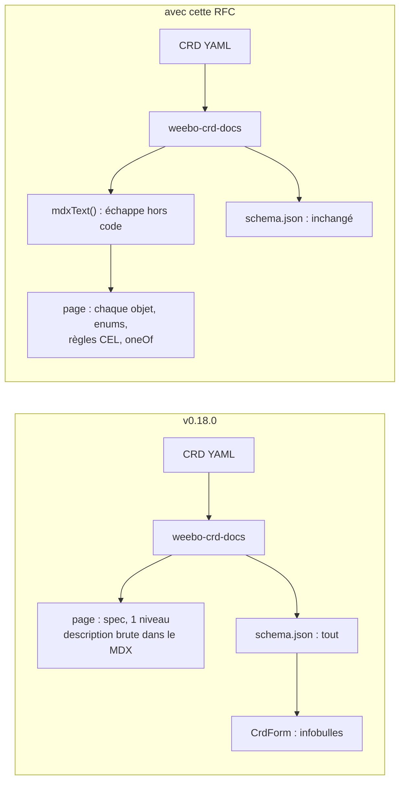
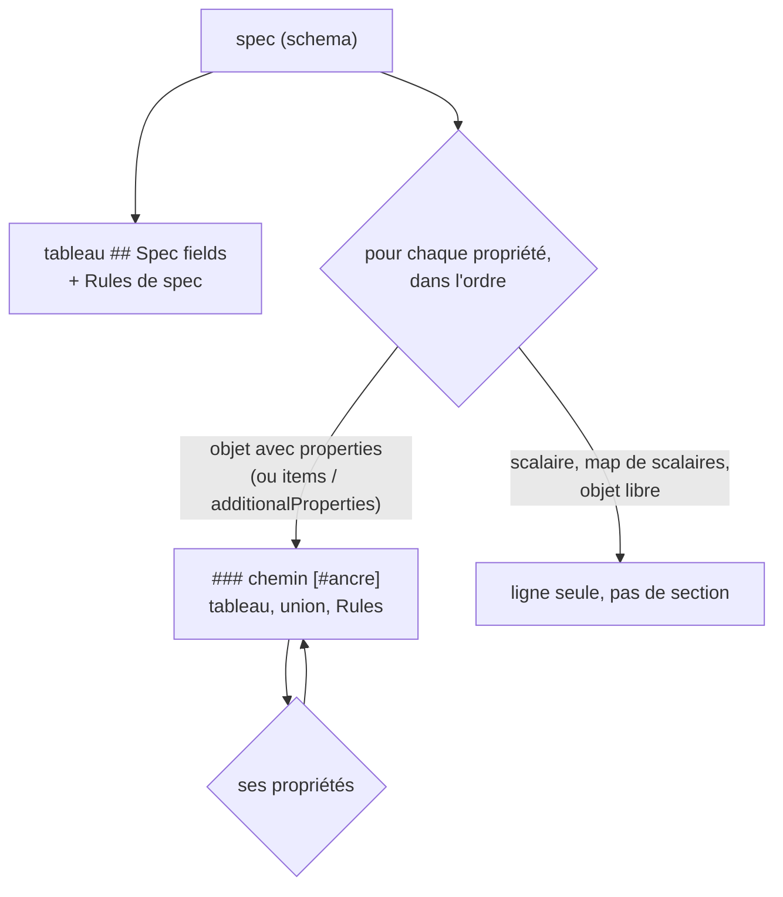
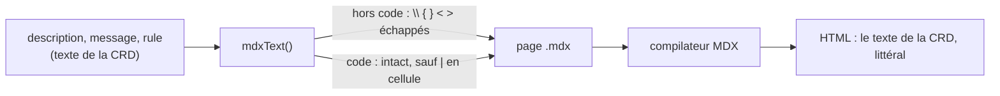
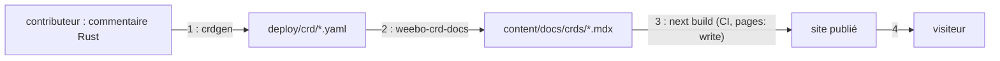

# RFC 0004 — Référence CRD : champs imbriqués et texte sûr pour MDX

| Field       | Value                                                                                  |
| ----------- | -------------------------------------------------------------------------------------- |
| Status      | Accepted (2026-10-19, après grill)                                                     |
| Short       | Référence CRD complète                                                                 |
| Settles     | Ce que `weebo-crd-docs` écrit sous le tableau des champs de `spec`, et comment il échappe le texte des CRD |
| Author      | Max Batleforc <maxleriche.60@gmail.com>                                                |
| Co-author   | Claude Opus 5.5                                                                        |
| Created     | 2026-10-18                                                                             |
| Supersedes  | —                                                                                      |
| Touches     | `packages/operator-docs/src/crd-docs/generate.mjs`, `packages/operator-docs/test/`, `packages/operator-docs/README.md` |
| Risk        | medium (§7 : le correctif ferme une exécution de code au build qui existe aujourd'hui) |

---

## 1. Summary

`weebo-crd-docs` ne met dans la page d'une kind que les champs de premier
niveau de `spec`. Tout ce qui est plus profond n'existe que dans le formulaire
(`<CrdForm>`), en infobulle. Cette RFC fait écrire au générateur, après le
tableau de `spec`, une section par objet imbriqué : son chemin en titre, son
tableau de champs, ses valeurs d'enum, ses règles CEL et ses choix exclusifs
(`oneOf`). Le texte des CRD passe par une seule fonction d'échappement avant
d'entrer dans le MDX. Aujourd'hui, une accolade ou un `<` dans une description
de premier niveau est interprété comme du JSX, et donc exécuté au build.

### Before / after

```text
# aujourd'hui (v0.18.0), content/docs/crds/proxykubeapi.mdx
## Spec fields
| `security_config` | `object` | no |  | Security configuration |
...                                    ← 10 lignes, fin de la référence

# avec cette RFC
## Spec fields
| [`security_config`](#spec.security_config) | `object` | no |  | Security configuration |
...
### `spec.security_config` [#spec.security_config]
| [`allowed_resources`](#spec.security_config.allowed_resources) | `object[]` | no | `[]` | Allowed resources, … |
### `spec.security_config.allowed_resources[]` [#spec.security_config.allowed_resources]
| `path` | `string` | yes |  | … `/apis/\{group\}/\{version\}/…` |
**Rules**
- path must not be empty — `self.path != ''`
...                                    ← une section par objet, jusqu'à la feuille
```



Le schéma JSON et le formulaire ne changent pas. Ce qui change, c'est le texte
de la page, le seul que la recherche et `llms.txt` indexent. Ce texte n'atteint
plus le compilateur MDX sans avoir été échappé.

---

## 2. Motivation

1. **La référence s'arrête au premier niveau.** `renderFieldsTable`
   (`src/crd-docs/generate.mjs:98-113`) ne lit que `specSchema.properties`. Le
   tableau ci-dessous compte, dans les CRD actuelles de chaque dépôt, les champs
   imbriqués qui ont une description et qui n'apparaissent dans aucune page :

   | Dépôt | Kinds | Champs | Imbriqués | Imbriqués décrits, absents de la page |
   | --- | --- | --- | --- | --- |
   | ProxyAuthK8S | 1 | 189 | 179 | 138 |
   | weebo-forgejo | 12 | 320 | 209 | 143 |
   | weebo-authentik | 11 | 123 | 66 | 34 |
   | weebo-angos | 4 | 376 | 314 | 199 |
   | weebo-batlehub | 6 | 360 | 323 | 274 |
   | weebo-stalwart | 3 | 24 | 16 | 11 |

   Ces descriptions ne vivent que dans `<CrdForm>`. Le formulaire en montre le
   premier paragraphe sur deux lignes (`line-clamp-2`), et le reste dans
   l'attribut `title` (`src/crd-form/fields.tsx:20-45`). Le formulaire est
   rendu côté client depuis `public/crd-schemas/*.json`. La recherche statique
   (`searchRoute`) et `llms.txt` (`llmsIndexRoute`, `getLLMText`) ne voient que
   le MDX : ces 799 descriptions sont donc introuvables par la recherche et
   absentes de ce que lit un agent.

2. **Le texte des CRD entre brut dans le MDX.** `escapeCell` (`:94-96`)
   n'échappe que `|` et les retours à la ligne. La description du `spec`
   (`:191`) est collée telle quelle dans la page (`:217`). En MDX, `{…}` est
   une expression JavaScript et `<x` ouvre un élément JSX. Or des descriptions
   en contiennent : 20 dans ProxyAuthK8S (`{{username}}`, `/apis/{group}/…`),
   23 dans weebo-forgejo, 11 dans weebo-authentik, 16 dans weebo-angos, 23 dans
   weebo-batlehub, 2 dans weebo-stalwart. Aujourd'hui, aucune n'est au premier
   niveau : c'est la seule raison pour laquelle les sites construisent. Rendre
   les champs imbriqués (motivation 1) sans échapper casserait tous les builds,
   ou pire, les ferait réussir (§7, T1).

3. **Les contraintes sont invisibles.** ProxyAuthK8S porte 30 règles
   `x-kubernetes-validations`, weebo-batlehub 23, weebo-forgejo et weebo-angos
   22 chacun. Il y a aussi 99 enums et 10 unions `oneOf` en tout. Aucune règle,
   aucune liste de valeurs, aucun « exactement un de » n'atteint la page. Un
   utilisateur découvre la règle au `kubectl apply`, par le message de
   l'apiserver.

4. **Un opérateur qui adopte le kit perd sa référence.** ProxyAuthK8S
   (RFC 0005 de ce dépôt-là, phase 3) remplace une page crdoc de 53 sections,
   une par objet de `ProxyKubeApi.spec`, par la page du kit. Sur un proxy de
   sécurité, `security_config` (règles d'accès, exec, port-forward) est
   justement ce qu'on vient lire. L'adoption est en attente de cette RFC.

5. **Les paragraphes sont aplatis.** `escapeCell` remplace chaque retour à la
   ligne par une espace, saut de paragraphe compris. Une description en deux
   paragraphes (« Kept as a real field rather than a serde alias on purpose: … »)
   devient une seule phrase sans respiration.

---

## 3. Goals / non-goals

**Goals**

- Chaque champ de `spec` qui a une description, à n'importe quelle
  profondeur, apparaît en texte sur la page de sa kind.
- Aucun caractère d'une CRD ne peut devenir une expression ou un élément MDX :
  le texte rendu est celui de la CRD, littéralement.
- Les valeurs d'enum, les défauts, les règles CEL (message et règle) et les
  choix exclusifs (`oneOf`/`anyOf` de `required`) sont écrits sur la page.
- Chaque objet a une ancre stable, dérivée de son chemin, liée depuis la ligne
  de son parent.
- Les sauts de paragraphe d'une description survivent dans une cellule.

**Non-goals**

- **Le support des enums serde externes (`oneOf` de `required`) dans
  `<CrdForm>`.** C'est un autre composant, avec un autre coût. La page les
  décrit ; le formulaire reste tel quel.
- **Le schéma `status`.** Ce que l'opérateur écrit n'est pas ce que
  l'utilisateur déclare. On peut le faire plus tard, avec la même fonction.
- **Plusieurs versions par CRD.** Toutes les CRD actuelles n'en ont qu'une.
  `versions[0]` (`:185`) reste, cf. *Deliberately untouched*.
- **Des sections repliables (`Accordion`).** Le contenu replié échappe au
  Ctrl-F du navigateur. Une page longue, avec une table des matières, se lit
  mieux.
- **Rendre obligatoires les descriptions des champs.** Un champ sans
  description reste une ligne avec une cellule vide, comme aujourd'hui (`:12-15`).
  En faire une erreur bloquerait les opérateurs pour une question de rédaction.
- **Changer le schéma JSON publié ou `index.json`.** `<CrdForm>` et
  `<CrdBuilder>` les lisent ; ils ne bougent pas.

---

## 4. User-facing design

### 4.1 Configuration

Aucune option nouvelle dans `crd-docs.config.mjs`. Le rendu complet est le
comportement par défaut, et il n'y a pas de drapeau pour revenir au premier
niveau seul : une référence tronquée n'est pas un réglage. Un opérateur qui
monte de version régénère ses pages (`task recu`, `npm run gen:crds`) et
relit le diff.

### 4.2 Behaviour rules

**Ordre et chemins.**

- La page garde son ordre : faits, description, exemple, `## Spec fields`
  (tableau de `spec`), puis les sections imbriquées, puis
  `## Build a manifest` et `<CrdForm>`.
- Les sections suivent un parcours en profondeur, dans l'ordre de déclaration
  des propriétés. C'est l'ordre des champs Rust, celui de crdoc.
- Un objet reçoit une section s'il a des `properties`. C'est aussi le cas d'un
  tableau (`items`) ou d'une map (`additionalProperties`) d'objets qui ont des
  `properties`.
- Le chemin s'écrit `spec.a.b`. Un tableau s'écrit `spec.a[]` et une map
  `spec.a[key]`. L'ancre est le chemin sans `[]` ni `[key]` (`spec.a.b`),
  posée avec la syntaxe d'ancre de Fumadocs (`### titre [#id]`, `headingIdRegex`
  de fumadocs-core). Elle ne dépend donc pas du slugger.
- Une profondeur sans section : un objet sans `properties`
  (`x-kubernetes-preserve-unknown-fields`, map de scalaires) reste une ligne de
  type `object` ou `map[string]string`, sans section.

**Cellules.**

- **Nom** : le nom du champ en code, avec un lien vers sa section quand il en a
  une.
- **Type** : comme aujourd'hui (`fieldType`). Les maps s'écrivent `map[<type>]`,
  et `format: int-or-string` s'écrit `int-or-string`.
- **Required** : `yes` ou `no`. Pour un champ d'une union, `one of` (`oneOf`)
  ou `any of` (`anyOf`).
- **Default** : comme aujourd'hui (`JSON.stringify`).
- **Description** : le texte échappé, suivi de `Values: \`a\`, \`b\`.` quand le
  champ a un `enum`. Un saut de paragraphe devient `<br /><br />` ; un simple
  retour à la ligne devient une espace, comme en Markdown.

**Ce qui suit le tableau d'une section.**

- Quand l'objet est une union dont chaque branche n'est qu'un `required` d'un
  seul champ, une ligne « Exactly one of `ConfigMap`, `Secret`, … » (`oneOf`)
  ou « At least one of … » (`anyOf`). Une autre forme de `oneOf` est écrite
  « Matches one of N shapes; see the schema », sans essayer de la décrire.
- Quand l'objet a des `x-kubernetes-validations`, une liste **Rules** : le
  `message`, puis la `rule` en code. Une règle sans `message` montre la règle
  seule. Les règles portées par `spec` lui-même suivent le tableau de
  `## Spec fields`.

**Le cas sans intérêt.** Une kind dont `spec` n'a que des scalaires produit
exactement la page d'aujourd'hui, à l'échappement près : pas de section, pas
de liste vide, pas de titre orphelin.

**Le texte.** Une seule fonction, `mdxText(text, { cell })`, voit tout le texte
qui vient d'une CRD : la description de `spec`, les cellules, les messages de
règles, le résumé de l'index (`:246`). Elle découpe le texte en spans de code
(séquences de backticks appariées, CommonMark).

- **Hors code**, elle échappe `\`, `{`, `}`, `<` et `>` par une barre oblique
  inverse.
- **Dans le code**, elle ne touche à rien : MDX n'y lit ni expression ni JSX,
  et un `\{` y serait affiché tel quel.
- **Avec `cell`**, elle échappe en plus `|` partout, code compris (GFM coupe la
  cellule même dans un span de code), et applique la règle des paragraphes.

La règle CEL est écrite dans un span de code assez long pour contenir ses
propres backticks.

### 4.3 Validation

Bloquant, au moment de la génération :

| Condition | Rationale |
| --- | --- |
| Inchangé : exemple manquant, champ inconnu, `required` absent (`checkExample`, `:130-139`) | l'exemple reste vérifié contre le schéma |
| Deux sections produiraient la même ancre (`spec.a[key]` et `spec.a` ne peuvent pas coexister, mais un champ nommé `a.b` le pourrait) | un lien mènerait au mauvais objet sans que personne le voie |

Avertissements :

| Condition | Behaviour | Surfaced in |
| --- | --- | --- |
| Champs sans description | comptés par kind, la page est écrite quand même | un `console.warn` du générateur, une ligne par kind concernée (`ForgejoRepository: 3 fields without a description`), lue dans la sortie de `task recu` |

---

## 5. Architecture

### 5.1 Le parcours



Un schéma structurel Kubernetes ne peut pas être récursif (l'apiserver refuse
`$ref`) : le parcours termine toujours, et il n'a pas besoin de limite de
profondeur.

### 5.2 Le texte



Invariant : la construction de la page ne concatène aucun texte venu d'une
CRD sans passer par `mdxText`. Le texte d'une CRD ne peut donc jamais devenir
une expression ni un élément MDX. Le test `crd text never reaches MDX as
code` (§14) compile et évalue chaque page générée à partir d'une fixture
hostile, et le vérifie.

---

## 6. Detailed design

### 6.1 `src/crd-docs/generate.mjs`

- `mdxText(text, { cell = false } = {})` remplace `escapeCell`. Elle est
  exportée pour le test.
- `fieldType(schema)` gagne `map[…]` (`additionalProperties`) et
  `int-or-string`.
- `renderFieldsTable(schema, path, anchors)` lit `schema.properties`,
  `schema.required` et `schema.oneOf`/`anyOf`. Il lie le nom quand le champ a
  une section, et ajoute `Values:` pour un enum.
- `renderSections(schema, path)` est récursif. Il renvoie le Markdown des
  sections de tous les descendants : titre, tableau, ligne d'union, `Rules`.
- `renderRules(schema)` construit la liste à partir de
  `x-kubernetes-validations`.
- `codeSpan(text)` choisit une clôture de backticks plus longue que la plus
  longue séquence que contient le texte.
- La description de `spec` (`:191`) et le résumé de l'index (`:246`) passent
  par `mdxText`. Le résumé du frontmatter reste dans `yaml.dump` (`:215`), qui
  échappe déjà pour YAML : le frontmatter n'est pas lu comme du MDX.
- Le compte des champs sans description est affiché par `generateCrdDocs`
  elle-même (`console.warn`), qui garde sa valeur de retour : le nombre de CRD
  (§15, décision 11). Aucun changement cassant, ni pour le binaire ni pour
  l'export `./crd-docs`.

### 6.2 `test/`

- `fixtures/crd/` gagne une kind `ExampleNested`. Sa `spec` a un objet, un
  tableau d'objets, une map d'objets, une map de scalaires, un enum, un
  `oneOf` de `required`, un `oneOf` d'une autre forme, des règles CEL (avec et
  sans message, une règle qui contient un backtick), et des descriptions
  hostiles : `{{username}}`, `/apis/{group}/{version}`, `<prefix>/<namespace>`,
  `a | b`, `\{`, un `<script>`, deux paragraphes.
- `@mdx-js/mdx` (déjà dans `package-lock.json` en 3.1.1, comme dépendance de
  `fumadocs-mdx`) devient une `devDependency` directe : le test compile
  (`compile`) et évalue (`evaluate` avec `react/jsx-runtime`) chaque page
  générée. `remark-gfm` (4.0.1, aussi déjà installé par `fumadocs-mdx`) la
  suit : sans lui, le compilateur ne lit pas les tableaux, et T3 ne se
  vérifie pas.

### 6.3 `README.md`

La section *The CRD reference generator* décrit la page : sections par objet,
ancres `#spec.a.b`, unions, règles, échappement. Elle explique aussi qu'une
description s'écrit en Markdown sans JSX.

### 6.P Proof against a real client

Les points 6 et 7, et le point 0 ci-dessous, prouvent la v0.18.1 (le
correctif, §16). Les autres prouvent la v0.19.0.

0. **v0.18.1, sans diff** : `gen:crds` avec la v0.18.1 dans weebo-forgejo et
   ProxyAuthK8S produit des pages identiques octet pour octet à celles de la
   v0.18.0. Aucune description du premier niveau des six dépôts ne contient
   `{`, `}`, `<` ou `\` hors code (vérifié le 2026-10-19 ; seul un `->` dans
   weebo-authentik, dont le rendu ne change pas).

Consommateurs : deux sites réels, construits avec Next 16.4 en export statique
comme sur GitHub Pages. weebo-forgejo, en npm, est le plus gros des sites
adoptés (12 kinds). ProxyAuthK8S, en pnpm, a l'unique CRD la plus profonde.
Chacun pointe sur le paquet par `file:` avec `npm install --install-links`
(README, *Installing*), puis sur la tarball de la release.

1. `npm run gen:crds` puis `next build` dans `weebo-forgejo/docs` :
   code 0, et le compte de champs sans description s'affiche.
2. `out/docs/crds/forgejorepository/index.html` contient une section
   `id="spec.fromTemplate"`, et la ligne `fromTemplate` du tableau de `spec`
   la lie (`href="#spec.fromTemplate"`).
3. Même chose dans ProxyAuthK8S :
   - `out/docs/crds/proxykubeapi/index.html` contient la section
     `spec.security_config.allowed_resources` ;
   - le texte `/apis/{group}/{version}/namespaces/{namespace}/` y apparaît
     littéralement (les accolades sont dans le HTML, pas de `\`) ;
   - la ligne `cert` dit `Exactly one of` avec ses cinq variantes.
4. La recherche : l'index statique (`out/api/search`) contient un mot qui
   n'existe que dans une description imbriquée (`allowed_ressources`,
   « Deprecated misspelling »). Il n'en contient aucun aujourd'hui.
5. `out/llms-full.txt` contient la règle CEL
   `!has(self.dashboard_group) || self.dashboard_group != ''` et son message.
6. **Refus : du code dans une description.** Une description de premier
   niveau est remplacée par
   `{(() => { require('node:fs').writeFileSync('/tmp/pwned', '1') })()}`.
   Après `gen:crds` et `next build`, `/tmp/pwned` n'existe pas, et la page
   montre ce texte tel quel. Contrôle : la même chose avec la v0.18.0 crée
   `/tmp/pwned` ou fait échouer le build (§7, T1).
7. **Refus : un élément dans une description.** `<script>alert(1)</script>`
   dans une description imbriquée apparaît sous forme `&lt;script&gt;` dans le
   HTML exporté. Aucune balise `<script>` ne vient du texte de la CRD
   (§7, T2).
8. **Refus : une ancre en double.** Une fixture avec un champ `a.b` à côté d'un
   objet `a` qui a un champ `b` fait échouer `gen:crds` avec un message qui
   nomme les deux chemins, et aucune page n'est écrite.

**Deliberately untouched**, so reviewers do not go looking :

- `src/crd-form/*` : le formulaire lit le schéma JSON, qui ne change pas.
- `versions[0]` (`:185`) au lieu de la version `storage` : une seule version
  partout. Le corriger est une ligne, mais aucun site ne pourrait l'observer.
- `src/reference/*` : les pages de référence de l'opérateur ont leur propre
  rendu, et leur texte vient du Rust, pas de la CRD.
- `checkExample` : la vérification des exemples ne descend pas plus bas que
  `spec`, comme aujourd'hui.

---

## 7. Security

**Rating:** medium — le générateur, sans le savoir, transforme aujourd'hui le
texte d'un commentaire Rust en code exécuté au build de la doc. Cette RFC
ferme ce chemin ; elle n'en ouvre aucun.

### 7.1 Threat model

Actifs : le job CI qui construit la doc (`docs-pages`, avec
`pages: write` et `id-token: write` dans les opérateurs), le site publié et
ses visiteurs.

Acteur : un contributeur qui ouvre une PR sur un opérateur. Il contrôle le
texte des commentaires de doc Rust, que `crdgen` copie dans les descriptions
de la CRD, puis le générateur dans la page.



| # | Threat (STRIDE) | Where | Mitigation | Residual risk |
| --- | --- | --- | --- | --- |
| T1 | Elevation : une expression `{…}` dans une description devient du JavaScript, évalué au prerender, dans le job qui a `pages: write` | 2 → 3 | `mdxText` échappe `{` et `}` hors code ; l'invariant §5.2 ; test `crd text never reaches MDX as code`, §6.P point 6 | la revue de la PR reste la défense contre un contributeur qui modifie le générateur ou le site lui-même, ce que cette RFC ne prétend pas couvrir ; accepté (mainteneur du kit) |
| T2 | Tampering / XSS : `<script>` ou `` dans une description devient un élément rendu sur le site | 2 → 4 | `mdxText` échappe `<` et `>` hors code ; React échappe le texte ; §6.P point 7 | aucun |
| T3 | Tampering : un `|` ou un saut de ligne dans une description casse le tableau et décale les colonnes (un « yes » qui devient « no » dans Required) | 2 | `mdxText({ cell: true })` échappe `|` partout et réécrit les sauts de ligne ; test sur la fixture `a | b` | aucun |
| T4 | Spoofing : un champ nommé `a.b` prend l'ancre de l'objet `a.b`, et le lien du parent mène à la mauvaise section | 2 | refus d'une ancre en double (§4.3) ; §6.P point 8 | aucun |
| T5 | DoS : une CRD énorme produit une page qui ne se construit pas | 2 → 3 | sans objet : la taille de la page est linéaire en nombre de champs, et l'apiserver borne déjà la taille d'une CRD | aucun |

Aujourd'hui, T1 et T2 sont ouverts sur la description de `spec` et sur les
champs de premier niveau (`:191`, `:217`, `:105`). Ils le seraient sur les
799 descriptions de la motivation 1 si on rendait les champs imbriqués sans
cette RFC.

### 7.2 Authentication and authorisation

Pas de nouvelle surface : un générateur hors ligne, lancé par le développeur
ou par la CI, sur des fichiers du dépôt. Le site publié est statique et
public, comme aujourd'hui.

### 7.3 Input handling and injection

- L'entrée est la CRD YAML du dépôt (js-yaml, `yaml.load`, schéma par défaut :
  pas de types JavaScript).
- La sortie est du MDX. L'échappement est contextuel (hors code, code, cellule),
  dans une seule fonction (§4.2) testée sur une fixture hostile.
- Les chemins de fichiers écrits ne changent pas : `<singular>.mdx` et
  `<singular>.schema.json`, avec `singular` validé par l'apiserver (DNS-1123).
- Aucune taille d'entrée n'est nouvelle.

### 7.4 Secrets and cryptography

Sans objet : ni secret ni cryptographie. Une CRD ne contient pas de secret, et
le générateur n'en lit pas.

### 7.5 Abuse and resource exhaustion

Le parcours termine (§5.1, un schéma structurel n'est pas récursif). La taille
de la page est proportionnelle au nombre de champs : estimée sous 150 Ko pour
la plus grosse kind actuelle. Elle sera mesurée en phase 1, et §6.P point 1
l'observe.

### 7.6 Existing defences that still hold

- `checkExample` refuse toujours un exemple qui ne correspond pas au schéma.
- `stripK8sExtensions` continue de retirer les extensions du schéma publié.
- `yaml.dump` échappe le frontmatter.

---

## 8. Supply chain

| Dependency / image / tool | Version | Why this one | Licence | Known CVEs (`task audit`) | Maintenance |
| --- | --- | --- | --- | --- | --- |
| `@mdx-js/mdx` (devDependency, test seulement) | 3.1.1, celle que `fumadocs-mdx` 15.4.6 installe déjà | le test doit compiler les pages avec le compilateur réel, pas une regex | MIT | aucune connue ; vérifié par `npm audit` dans `task docs:check` | projet unified, release 3.1.1 |
| `remark-gfm` (devDependency, test seulement) | 4.0.1, celle que `fumadocs-mdx` 15.4.6 installe déjà | les tableaux GFM du site, pour compter les colonnes (T3) | MIT | aucune connue ; vérifié par `npm audit` dans `task docs:check` | projet unified, release 4.0.1 |

- **Build and release** : la tarball ne change pas de forme (`files` de
  `package.json` inchangé). La devDependency n'est pas publiée.
- **Updates** : Dependabot du kit, comme les autres devDependencies du paquet.

---

## 9. Data and privacy

| Data | Personal? | Where stored | Retention | Who can read it | Leaves the instance? |
| --- | --- | --- | --- | --- | --- |
| Descriptions, règles et enums des CRD, désormais rendus en texte | non : du texte de schéma écrit par les mainteneurs | `content/docs/crds/*.mdx`, site publié | celle du dépôt | public, comme le schéma JSON déjà publié | déjà publiées dans `public/crd-schemas/*.json` |

Aucune donnée nouvelle : la page montre ce que le schéma JSON publié contient
déjà.

---

## 10. Operability

### 10.1 Observability

- **Metrics** : aucune, le générateur ne tourne pas en production.
- **Logs** : une ligne de sortie, avec le compte des champs sans description
  (§4.3).
- **Alerts** : aucune, parce qu'il n'y a rien qui tourne.

### 10.2 Failure modes

| Failure | Detected by | Behaviour (fail open / closed) | Recovery |
| --- | --- | --- | --- |
| Ancre en double | le générateur | fermé : erreur, aucune page écrite | renommer le champ |
| Forme de schéma inconnue (`oneOf` non `required`, `allOf`) | rien à détecter | ouvert, volontairement : une ligne générique « Matches one of N shapes » plutôt qu'une erreur ; la page reste correcte, juste moins précise | une PR kit pour la forme |
| MDX invalide malgré l'échappement | `next build` de l'opérateur, et le test du kit avant | fermé : le build échoue | corriger `mdxText` |

### 10.3 Performance and capacity

La génération reste sous la seconde : quelques milliers de champs, sans I/O
par champ. Le build Next d'une page plus longue sera mesuré au point 1 de
§6.P, avant et après sur weebo-forgejo. Le budget est +20 % de temps de build
au plus.

---

## 11. Other concerns

- **Accessibility** : les sections sont des titres `###` dans l'ordre (la
  table des matières de Fumadocs les liste), les tableaux restent des
  tableaux, et les liens ont pour texte le nom du champ.
- **Internationalisation** : le texte fixe du générateur est en anglais, comme
  aujourd'hui (« Spec fields », « Rules », « Exactly one of »). Les
  descriptions sont dans la langue du Rust.
- **Compliance** : sans objet.
- **Licensing** : inchangé (MIT).
- **Documentation** : le README du paquet (§6.3), et le CHANGELOG généré par
  cog (`fix` pour la v0.18.1, `feat` pour la v0.19.0).

---

## 12. Alternatives considered

| Alternative | Why rejected |
| --- | --- |
| Ne rien faire | la motivation 4 bloque une adoption, et T1/T2 restent ouverts sur la description de `spec` |
| crdoc dans chaque opérateur, à côté de la page du kit | ProxyAuthK8S l'a fait : un binaire Go, un `perl` pour échapper les accolades, `add-frontmatter.sh`, et deux références qui divergent ; le kit existe pour ne pas recopier ça six fois |
| Une page par objet imbriqué | 53 pages pour ProxyKubeApi dans la barre latérale, et la référence d'un champ ne tient plus sur une page qu'on parcourt |
| Rendre les descriptions dans `<CrdForm>` en entier | le texte resterait hors de la recherche et de `llms.txt` (motivation 1), et le formulaire deviendrait une référence illisible |
| Échapper avec une regex unique, sans distinguer le code | `\{` dans un span de code s'affiche avec sa barre oblique : `{{username}}` en code deviendrait faux ; c'est le bug que le `perl` de ProxyAuthK8S contournait déjà |
| Écrire les pages en `.md` (pas d'expressions en Markdown pur) | la page porte `<CrdForm>`, qui exige du MDX |

---

## 13. Rollout and compatibility

- **Default behaviour** : à la prochaine régénération, chaque page gagne ses
  sections. Les URLs existantes ne bougent pas, et les nouvelles ancres
  s'ajoutent.
- **Migration** : `kit:sync TAG=vX.Y.Z`, puis `task recu` (ou
  `npm run gen:crds`) dans chaque opérateur ; le diff des pages se relit dans
  la PR. Réversible : le tag précédent régénère les pages d'avant.
- **Operator prerequisites** : aucun.
- **Rollback** : revenir au tag précédent. Ce retour rouvre T1/T2 sur le
  premier niveau, qui sont ouverts aujourd'hui.
- **Version** : deux releases. La **v0.18.1** (patch, `fix`) contient
  l'échappement seul. La **v0.19.0** (mineure, `feat`, sans changement
  cassant) contient les sections imbriquées. ProxyAuthK8S vise directement la
  v0.19.0.

---

## 14. Test plan

- **Unit** (`test/crd-docs.test.mjs`) :
  - `mdxText` : hors code, code, cellule, backticks appariés et orphelins,
    barre oblique inverse, deux paragraphes ;
  - `fieldType` : maps et int-or-string ;
  - `codeSpan` : une règle qui contient un backtick.
- **Integration** (même fichier) : la fixture `ExampleNested` produit, pour
  chaque objet, une section avec son ancre et son lien ; `Values:` pour
  l'enum ; `Exactly one of` ; `Rules` ; une page inchangée pour la kind qui
  n'a que des scalaires (`ExampleGadget`).
- **Proof** : §6.P.
- **Security** :
  - T1, T2 : `crd text never reaches MDX as code`. Chaque page générée est
    compilée et évaluée avec `@mdx-js/mdx`, sans erreur. Le rendu contient
    `{{username}}` et `<script>` en texte. Aucun élément `script` n'est
    produit, et un `{…}` qui écrirait un fichier n'écrit rien.
  - T3 : `a | b` reste dans sa cellule (nombre de colonnes constant).
  - T4 : `duplicate anchors are refused`.
- **Audit** : `npm audit` du paquet reste vert.
- **Existing suites** : `task docs:check` (tsc contre les planchers des peers,
  tests du générateur et de la référence) inchangé en résultat.

---

## 15. Decisions and open questions

### Resolved

| # | Question | Decision |
| --- | --- | --- |
| 1 | Forme de l'ancre | **Le chemin avec ses points** (`#spec.security_config`). Il se lit comme le chemin ; aucun sélecteur CSS ne le vise. |
| 2 | Règles CEL | **`message` et `rule`, la règle en code.** Le message seul ment parfois par omission. |
| 3 | Paragraphes dans une cellule | **`<br /><br />` pour un paragraphe, une espace pour un simple retour à la ligne** (règle Markdown). |
| 4 | Champs sans description | **Comptés, sans bloquer.** Le manque se voit dans chaque PR. |
| 5 | Release | **Deux releases dédiées**, voir 6 et 14. |
| 6 | Correctif et fonctionnalité ensemble ? | **Séparés.** T1/T2 sont ouverts aujourd'hui : l'échappement sort seul en v0.18.1, avant la partie longue. |
| 7 | Markdown des descriptions | **Gardé** : échappement de `\ { } < >` hors code, plutôt qu'un rendu en texte brut qui afficherait les backticks. |
| 8 | Forme de schéma inconnue | **Ligne générique, sans erreur** (§10.2). |
| 9 | Hors périmètre | **Confirmé** : schéma `status`, versions multiples, `oneOf` serde dans `<CrdForm>`. |
| 10 | Budget et preuve | **weebo-forgejo et ProxyAuthK8S, +20 % de temps de build au plus** ; au-delà, retour à la RFC avant la release. |
| 11 | Valeur de retour de `generateCrdDocs` | **Inchangée** ; le compte passe par `console.warn` dans la fonction. Pas de `feat!`. |
| 12 | Contenu de la v0.18.1 | **`mdxText` sur le texte déjà rendu** (description de `spec`, cellules, index) **et son test** (`@mdx-js/mdx`, fixture hostile). Les paragraphes attendent la v0.19.0 : ils changent le rendu. |
| 13 | Preuve de la v0.18.1 | **§6.P points 0, 6 et 7** : pages identiques octet pour octet sur les deux sites, et les deux refus sur une description du premier niveau. |
| 14 | ProxyAuthK8S | **Vise directement la v0.19.0** : la v0.18.1 ne lui apporte pas les champs imbriqués. |

### Still open

Aucune.

---

## 16. Implementation phases

| Phase | Content |
| --- | --- |
| 1 | `fix(operator-docs): escape CRD text before it reaches MDX`. `mdxText` sur la description de `spec`, les cellules et le résumé de l'index ; fixture hostile au premier niveau ; test qui compile et évalue chaque page ; `@mdx-js/mdx` en devDependency. Release **v0.18.1**, preuve §6.P 0, 6, 7. Utile seule : elle ferme T1/T2 sur les six opérateurs |
| 2 | `feat(operator-docs): nested CRD fields`. Sections, ancres, unions, règles, enums, paragraphes, compte des champs sans description, refus des ancres en double ; fixture `ExampleNested`, README. Release **v0.19.0**, preuve §6.P 1 à 5 et 8, budget §15.10. L'échappement qui protège les nouvelles sections est déjà en place depuis la phase 1 |
| 3 | weebo-forgejo et ProxyAuthK8S passent en v0.19.0 (RFC 0005 phase 3 côté ProxyAuthK8S), puis les autres opérateurs à leur prochain `kit:sync` |
