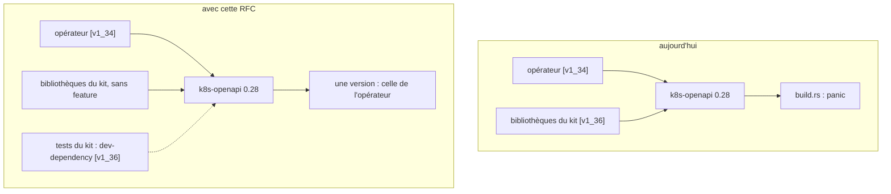

# RFC 0005 — `k8s-openapi` : les bibliothèques du kit ne choisissent plus la version de Kubernetes

| Field       | Value                                                                  |
| ----------- | ---------------------------------------------------------------------- |
| Status      | Accepted (2026-10-19, après grill)                                     |
| Short       | Feature de version `k8s-openapi` hors des bibliothèques                |
| Settles     | Qui choisit la version de Kubernetes que compilent les crates `weebo-kit-*` |
| Author      | Max Batleforc <maxleriche.60@gmail.com>                                |
| Co-author   | Claude Opus 5.5 (1M context), depuis la RFC 0011 de ProxyAuthK8S       |
| Created     | 2026-10-19                                                             |
| Supersedes  | —                                                                      |
| Touches     | `Cargo.toml` (workspace), `crates/weebo-kit-{api,application,adapters,runtime,perf}/Cargo.toml` (dev-dependencies), `mise.toml` (`[env]`), `.github/workflows/ci.yml` (matrice), `README.md`, un test de garde ; le template (`templates/operator/Cargo.toml`) ne change pas |
| Risk        | low (§7) : un changement de build, sans code ni surface nouvelle       |

---

## 1. Summary

Le workspace du kit déclare `k8s-openapi = { version = "0.28", features =
["v1_36", "schemars"] }` (`Cargo.toml:38`), et ses bibliothèques en héritent
(`weebo-kit-api`, `-application`, `-adapters`, `-runtime`, `-perf`). Un
opérateur qui compile pour une autre version de Kubernetes ne peut donc pas
dépendre d'une seule crate du kit : `k8s-openapi` refuse deux features de
version dans un même graphe. Cette RFC retire la feature des bibliothèques,
comme `k8s-openapi` l'exige, et laisse le choix à l'application : le binaire
de chaque opérateur (le template garde `v1_36`), ou ProxyAuthK8S, qui compile
en `v1_34`. Les tests et les commandes du kit gardent `v1_36` par une
dev-dependency et par `K8S_OPENAPI_ENABLED_VERSION`.

### Before / after

```text
# aujourd'hui, dans un opérateur en v1_34 qui ajoute weebo-kit-runtime
$ cargo check -p controller
error: failed to run custom build command for `k8s-openapi v0.28.0`
  Both v1_34 and v1_36 features are enabled on the k8s-openapi crate. […]
  If you are writing a library crate, do not enable any features at all.

# avec cette RFC
$ cargo check -p controller
    Finished […]
$ cargo tree -e features -i k8s-openapi | grep -o 'feature "v1_[0-9]*"' | sort -u
feature "v1_34"
```



Seul l'opérateur choisit ; les bibliothèques du kit compilent pour la version
qu'il a choisie.

---

## 2. Motivation

1. **Un opérateur qui n'est pas en `v1_36` ne peut pas utiliser le kit.**
   ProxyAuthK8S compile en `v1_34` (son `Cargo.toml:29`) et veut
   `weebo-kit-domain`, `-api` et `-runtime` (sa RFC 0011 : conditions,
   Events, codes de raison). Constaté le 2026-10-19 sur des copies (`git
   archive origin/main`, kit v0.18.2) : l'ajout fait échouer `cargo check`
   avec le message de l'exemple ci-dessus.
2. **Le kit viole la règle de `k8s-openapi`.** `src/lib.rs:75-77` de 0.28.0 :
   « If you're writing a library crate, your crate *must not* enable any
   features of `k8s-openapi` directly. The choice of which feature to enable
   must be left to any application crates that use your library. » Le
   message de `build.rs` en cas de doublon demande de « file a bug against
   them, citing this text ».
3. **Monter la version de Kubernetes devient un changement cassant pour
   tous.** Aujourd'hui, passer le kit en `v1_37` obligerait chaque opérateur à
   suivre le même jour. Avec cette RFC, le kit peut monter sa version de test
   sans toucher les opérateurs.

---

## 3. Goals / non-goals

**Goals**

- Aucune bibliothèque du kit n'active de feature `v1_*` de `k8s-openapi`.
- Les tests, `clippy`, `doc` et la couverture du kit gardent une version
  (`v1_36`), sans qu'on ait à y penser.
- Le template d'opérateur et les opérateurs existants (en `v1_36`) compilent
  sans changement. Vérifié le 2026-10-19 : weebo-forgejo, -authentik, -angos,
  -batlehub et -stalwart déclarent tous `k8s-openapi` avec `v1_36` dans leur
  propre `Cargo.toml`, ils n'héritent pas de celle du kit.
- La plage annoncée (1.32 à 1.36, `earliest`/`latest` de `k8s-openapi` 0.28)
  est vérifiée en CI, version par version (décision 2).

**Non-goals**

- **Changer la version de test du kit.** Elle reste `v1_36`.
- **Garantir une compatibilité au-delà de ce que le code permet.** Le kit
  compile aujourd'hui de 1.32 à 1.36 (vérifié pour 1.32 et 1.34) ; s'il
  utilise un jour un champ propre à une version, il le fera avec les macros
  `k8s_if_*` de `k8s-openapi`, ou il documentera son plancher.
- **Publier les crates sur crates.io.** Décision séparée.

---

## 4. User-facing design

### 4.1 Configuration

```toml
# Cargo.toml du kit (workspace)
k8s-openapi = { version = "0.28", features = ["schemars"] }   # plus de v1_36

# crates/weebo-kit-<x>/Cargo.toml, pour celles qui ont des tests
[dev-dependencies]
k8s-openapi = { workspace = true, features = ["v1_36"] }

# mise.toml du kit : cargo check, doc, et tout ce qui ne compile pas les dev-dependencies
[env]
K8S_OPENAPI_ENABLED_VERSION = "1.36"
```

- `templates/operator/Cargo.toml:49` garde `features = ["v1_36", "schemars"]` :
  c'est une application.
- `K8S_OPENAPI_ENABLED_VERSION` et la feature `v1_36` ensemble ne font pas
  doublon : `build.rs` de 0.28.0 les réunit dans un `BTreeSet`. Deux versions
  différentes, en revanche, échouent, comme aujourd'hui.

### 4.2 Behaviour rules

- Une bibliothèque du kit déclare `k8s-openapi = { workspace = true }`, sans
  feature, toujours.
- La version vient de l'application qui la compile. Dans le dépôt du kit,
  c'est la dev-dependency (tests, `clippy --all-targets`, `llvm-cov
  --all-targets`) ou la variable de `mise.toml` (`cargo check`, `cargo doc`).
- Pour un opérateur en `v1_36` (le template, weebo-forgejo, …), rien ne
  change : sa feature est la seule du graphe, comme avant.

### 4.3 Validation

| Condition | Rationale |
| --- | --- |
| Une bibliothèque du kit active une feature `v1_*` | un test du kit (§6.2) le refuse en lisant les `Cargo.toml` : sinon la régression ne se voit que chez un opérateur d'une autre version |

---

## 5. Architecture

Invariant : dans un graphe Cargo, l'unique feature de version vient de
l'application. Parce que le kit n'en active aucune, un opérateur ne peut plus
en avoir deux, quelle que soit la version qu'il choisit dans la plage que le
code du kit supporte.

---

## 6. Detailed design

### 6.1 Manifestes

- `Cargo.toml` : retrait de `"v1_36"` à la ligne 38.
- `[dev-dependencies] k8s-openapi = { workspace = true, features = ["v1_36"] }`
  dans les crates qui ont des tests : `weebo-kit-api` (12 marqueurs de test),
  `-application` (38), `-adapters` (65, et `tests/`), `-runtime` (59, et
  `tests/`), `-perf` (15). `weebo-kit-domain` ne dépend pas de
  `k8s-openapi` ; `weebo-kit-testkit` n'a pas de test mais en dépend : il
  compile sous `K8S_OPENAPI_ENABLED_VERSION` ou dans les tests des autres.
- `mise.toml` : `[env] K8S_OPENAPI_ENABLED_VERSION = "1.36"`. Les tâches
  `rust:*` et `doc` passent toutes par `mise exec` (`tasks/rust.yaml:31-58`,
  `Taskfile.yaml:57`, `:62`).

### 6.2 Garde

Un test Rust (décision 3), dans `weebo-kit-domain` pour rester sans
dépendance : il lit par `include_str!` le `Cargo.toml` du workspace et celui
de chaque crate `weebo-kit-*`, et refuse une feature `v1_*` de `k8s-openapi`
hors d'un `[dev-dependencies]`, avec un message qui nomme le fichier. Une
lecture ligne à ligne suffit (section courante, ligne `k8s-openapi`), sans
crate `toml`. Il tourne partout où `cargo test` tourne, CI comprise.

### 6.4 Matrice CI

Un job `k8s-versions` dans `.github/workflows/ci.yml` du kit, en matrice sur
1.32, 1.33, 1.34, 1.35 et 1.36 : `cargo check --workspace --lib` avec
`K8S_OPENAPI_ENABLED_VERSION` à la version du job (décision 2). Un `check`
sans les cibles de test, donc sans la dev-dependency `v1_36`, qui ferait
doublon. Les bornes suivent `earliest`/`latest` de `k8s-openapi` : une montée
de `k8s-openapi` met la matrice à jour dans la même PR. Ce workflow est celui
du kit, pas `checks.yml` que consomment les opérateurs.

### 6.3 README

Une section « Kubernetes version » : le kit ne choisit pas la version ;
l'opérateur active la feature `v1_*` de `k8s-openapi` dans son workspace, à
la version minimale d'apiserver qu'il supporte (formule du message de
`build.rs` de `k8s-openapi`) ; le kit est testé en 1.36 et compile de 1.32 à
1.36, vérifié en CI pour chaque version (§6.4) (décision 4).

### 6.P Proof against a real client

Le consommateur réel est un opérateur qui compile le kit pour une autre
version : ProxyAuthK8S (`v1_34`), sur la branche de sa RFC 0011, avec les
crates du kit par git sur la branche de cette RFC, puis sur le tag.

1. **Avant** (fait le 2026-10-19 sur des copies) : `cargo check -p
   controller` de ProxyAuthK8S avec `weebo-kit-runtime` échoue : « Both v1_34
   and v1_36 features are enabled on the k8s-openapi crate ».
2. **Après** (fait sur des copies, à refaire sur la branche) : la même
   commande passe, et `cargo tree -e features -i k8s-openapi` ne montre que
   `v1_34`.
3. **Plage** (fait sur une copie) : sans la feature, `cargo check` des
   crates domain, api, runtime, application et adapters passe avec
   `K8S_OPENAPI_ENABLED_VERSION` à 1.34 et à 1.32.
4. **Rien ne change pour un opérateur en `v1_36`** : `task template:check`
   (le template généré, compilé et testé) et `kit:sync` dans weebo-forgejo
   passent sans modifier leur `Cargo.toml`.
5. **Le kit seul** : `task lint`, `task test`, `task doc` et `task
   rust:coverage` passent dans le dépôt du kit, grâce à la dev-dependency et à
   la variable de `mise.toml`.
6. **Refus** : remettre `"v1_36"` dans `[workspace.dependencies]` fait échouer
   la garde de §6.2, avec un message qui nomme le fichier.
7. **Matrice** : le job `k8s-versions` passe sur les cinq versions.

**Deliberately untouched** :

- `templates/operator/**/Cargo.toml` : le template est une application, il
  garde sa feature.
- Le code des crates : aucun champ propre à une version n'est utilisé
  (point 3).

---

## 7. Security

**Rating:** low — un changement de build ; aucune surface, aucune donnée,
aucun droit nouveau.

### 7.1 Threat model

Aucune frontière de confiance ne bouge : mêmes sources, mêmes versions, même
code.

| # | Threat (STRIDE) | Where | Mitigation | Residual risk |
| --- | --- | --- | --- | --- |
| T1 | Tampering (intégrité du build) : un opérateur compile le kit pour une version que son code ne supporte pas, et obtient un comportement faux à l'exécution | build de l'opérateur | `k8s-openapi` échoue à la compilation sur un champ absent de la version choisie ; aucune différence de comportement à l'exécution pour les mêmes champs ; README (plage 1.32 à 1.36) | aucun |

### 7.2 Authentication and authorisation

Sans objet : aucune surface.

### 7.3 Input handling and injection

Sans objet : aucun parseur.

### 7.4 Secrets and cryptography

Sans objet.

### 7.5 Abuse and resource exhaustion

Sans objet.

### 7.6 Existing defences that still hold

`cargo deny` (sources, licences, avis) inchangé.

---

## 8. Supply chain

Aucune dépendance, image, action ou outil nouveau : `k8s-openapi` reste en
0.28, déjà présent ; seule sa feature change de place. `task audit`
inchangé.

---

## 9. Data and privacy

Aucune donnée nouvelle, ni stockée ni transmise : le changement est dans les
manifestes de build.

---

## 10. Operability

- **Observability** : aucune métrique, aucun log nouveaux.
- **Failure modes** : une bibliothèque qui remettrait une feature est
  refusée par la garde (§6.2) ; un opérateur qui oublierait d'en activer une
  échoue à la compilation avec le message de `k8s-openapi` (« None of the
  v1_* features are enabled »), ce qui est déjà le cas pour toute application
  qui dépend de `k8s-openapi`.
- **Performance** : aucune.

---

## 11. Other concerns

- **Accessibility** : pas d'UI.
- **Internationalisation** : sans objet.
- **Compliance** : sans objet.
- **Licensing** : inchangé.
- **Documentation** : README (§6.3) ; le CHANGELOG (cog) l'annonce comme un
  `fix`.

---

## 12. Alternatives considered

| Alternative | Why rejected |
| --- | --- |
| Ne rien faire, chaque opérateur passe en `v1_36` | le kit impose sa version à tous, et chaque montée de version du kit devient cassante pour tous (motivation 3) |
| Une feature par version dans les crates du kit (`k8s-v1_34`, …) | plus de configuration pour le même résultat, et un opérateur qui l'oublie retombe dans le doublon |
| `K8S_OPENAPI_ENABLED_VERSION` seule, sans dev-dependency | un `cargo test` lancé hors de `mise` (IDE, rust-analyzer) échouerait ; la dev-dependency couvre ce cas |

---

## 13. Rollout and compatibility

- **Default behaviour** : pour un opérateur en `v1_36`, rien ne change.
- **Migration** : aucune pour les opérateurs du template ; pour un opérateur
  dans une autre version, ajouter les crates du kit devient possible.
- **Rollback** : revenir au tag précédent ; un opérateur hors `v1_36` perd
  alors l'accès aux crates.
- **Version** : un `fix` (patch) : aucun opérateur ne change de comportement.

---

## 14. Test plan

- **Unit** : la garde de §6.2.
- **Integration** : `task template:check`, le job `k8s-versions` (§6.4).
- **Proof** : §6.P.
- **Security** : T1, par §6.P point 3 (la plage compile).
- **Audit** : `task audit` inchangé.
- **Existing suites** : `task lint`, `task test`, `task doc`,
  `task rust:coverage`, `task docs:check`.

---

## 15. Decisions and open questions

### Resolved

| # | Question | Decision |
| --- | --- | --- |
| 1 | PR directe ou RFC ? | **RFC**, décidé au grill de la RFC 0011 de ProxyAuthK8S (sa décision 2) : le changement touche tous les opérateurs du kit. |
| 2 | Comment garder la plage honnête ? | **Une matrice CI de 1.32 à 1.36** (§6.4), plutôt qu'un seul `check` au plancher : chaque version annoncée est compilée. Grill du 2026-10-19. |
| 3 | La garde : test Rust ou script de `repo:lint` ? | **Test Rust** dans `weebo-kit-domain` (§6.2) : il tourne partout où `cargo test` tourne. |
| 4 | Que dit le README ? | **La plage (1.32 à 1.36) et la version de test (1.36)** (§6.3), la plage étant vérifiée par la décision 2. |
| 5 | Patch ou mineure ? | **Patch** : aucun opérateur ne change, tous déclarent leur feature (§3). |

### Still open

Aucune.

---

## 16. Implementation phases

| Phase | Content |
| --- | --- |
| 1 | `fix: let the operator choose the k8s-openapi version` : manifestes, `mise.toml`, garde, matrice CI, README ; release patch. Preuve §6.P 2 à 7 |

---

## Références

- `k8s-openapi` 0.28.0 : `src/lib.rs:60-81` (règle des bibliothèques),
  `build.rs` (refus de deux versions, `BTreeSet`, message « minimum version
  of API server »), `Cargo.toml:52-61` (`earliest = v1_32`, `latest =
  v1_36`).
- weebo-operator-kit v0.18.2 : `Cargo.toml:38`, `crates/*/Cargo.toml`,
  `templates/operator/Cargo.toml:49`, `tasks/rust.yaml`, `Taskfile.yaml`.
- ProxyAuthK8S : RFC 0011 (`.rfc/0011-adopt-kit-runtime-crates.md`, §6.1,
  §15 décisions 2, 5 et 15), `Cargo.toml:29`.

## Changelog

| Date | Changement |
| --- | --- |
| 2026-10-19 | Brouillon, écrit depuis la RFC 0011 de ProxyAuthK8S |
| 2026-10-19 | Déposée dans le kit ; grill : matrice CI 1.32 à 1.36 (décision 2), garde en test Rust (3), plage et version de test au README (4), patch (5) ; opérateurs vérifiés (tous déclarent `v1_36`) ; `testkit` retiré des *Touches* (pas de test) |
