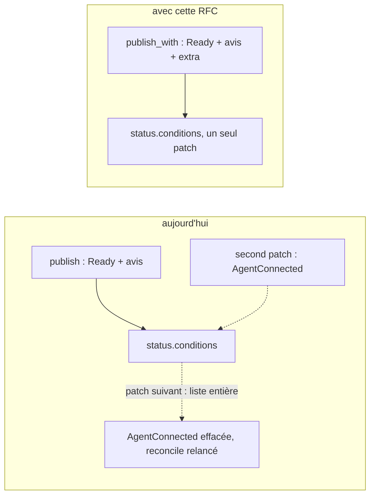

# RFC 0006 — Conditions typées : un type de condition propre à l'opérateur, publié avec `Ready`

| Field       | Value                                                                  |
| ----------- | ---------------------------------------------------------------------- |
| Status      | In review (PR #32, implémentation comprise)                            |
| Short       | Conditions typées dans `status::publish_with`                          |
| Settles     | Comment un opérateur publie une condition de son propre type (`True`/`False`/`Unknown`) sans qu'elle soit défaite par le patch suivant |
| Author      | Max Batleforc <maxleriche.60@gmail.com>                                |
| Co-author   | Claude Opus 5.5 (1M context), depuis la RFC 0012 de ProxyAuthK8S       |
| Created     | 2026-10-25                                                             |
| Supersedes  | —                                                                      |
| Touches     | `crates/weebo-kit-runtime/src/conditions.rs` (`TypedCondition`, `conditions_with`, un test), `crates/weebo-kit-runtime/src/status.rs` (`publish_with`, `publish` y délègue), `site/content/docs/architecture.mdx`, `site/content/docs/rfcs.mdx`, `docs/plan.md` |
| Risk        | low (§7) : deux fonctions publiques et un type ajoutés, `publish` inchangé |

---

## 1. Summary

`weebo_kit_runtime::status::publish` écrit la liste entière de
`status.conditions` : `Ready`, puis une condition par avis, de type égal à la
raison et toujours `True` (`conditions::conditions`). Un opérateur qui veut
une condition d'un autre type, avec un statut qui peut valoir `False` ou
`Unknown` (un tunnel connecté, une dépendance dégradée), n'a aucune place
pour elle. Cette RFC ajoute `conditions::TypedCondition<R>`,
`conditions::conditions_with` et `status::publish_with` : les conditions de
l'opérateur partent dans le même merge patch que `Ready` et les avis, avec
la même règle de `lastTransitionTime`. `publish` délègue à `publish_with`
avec une liste vide et ne change pas.

### Before / after

```rust
// aujourd'hui : rien ne porte AgentConnected=False
status::publish(&api, &recorder, FM, &obj, &previous, update).await?;

// avec cette RFC
let agent = TypedCondition {
    type_: "AgentConnected",
    status: Some(false),             // True / False / None = Unknown
    reason: ReasonCode::AgentNoTunnel,
    message: "no tunnel open".into(),
};
status::publish_with(&api, &recorder, FM, &obj, &previous, update, &[agent]).await?;
```



---

## 2. Motivation

1. **ProxyAuthK8S ne peut pas publier `AgentConnected`.** Sa RFC 0012 (mode
   agent, tunnel sortant) décide, décision 17 (§15, « Statut et
   observabilité ») : « **Présences dans Redis agrégées par le leader** en
   `AgentConnected` et `status.agent` ». Son §6.1 décrit « la condition
   `AgentConnected` (reasons `Connected`, `Degraded`, `NoTunnel`, `Refused`),
   au format des conditions de la RFC 0011 ». Son §17, « Écarts », constate
   que ce n'est pas possible avec le kit :

   > **Pas de condition `AgentConnected`** (§6.1, décision 17) : la
   > publication du kit (`weebo_kit_runtime::status::publish`) n'écrit que
   > `Ready` et une condition par avis, de type égal à la raison et toujours
   > `True` ; un second patch qui ajouterait `AgentConnected` serait défait par
   > le suivant, et chaque écriture relance un reconcile. L'état du tunnel est
   > donc la raison de `Ready` (`AgentNoTunnel`), le détail `status.agent`.
   > `Degraded` et `Refused` attendent un type de condition libre dans le kit
   > (correctif à proposer au kit, pas ici).

2. **Un second patch ne marche pas.** `publish` envoie la liste
   `conditions` entière dans un merge patch : une liste remplace la
   précédente. Une condition écrite par un autre patch disparaît au reconcile
   suivant, revient au patch d'après, et chaque écriture qui change le statut
   relance un reconcile : la CR oscille.
3. **Le kit est déjà le format adopté.** La RFC 0011 de ProxyAuthK8S
   (« Adopter les crates runtime du kit ») a fait passer son contrôleur sur
   `status::publish` : `Ready`, les avis en conditions `True`
   (`RulesRestricted`, `DeprecatedInsecureCert`), `lastTransitionTime` qui
   ne bouge que quand le statut change, et un statut publié à chaque
   reconcile sans garde d'égalité, parce que le patch d'une CR saine est
   identique au précédent. Une condition de plus doit suivre les mêmes
   règles, donc passer par le même code.

---

## 3. Goals / non-goals

**Goals**

- Une condition d'un type choisi par l'opérateur, de statut `True`, `False`
  ou `Unknown`, avec un de ses codes de raison, publiée dans le même patch
  que `Ready` et les avis.
- `lastTransitionTime` d'une telle condition ne bouge que quand son statut
  change, comme pour `Ready` : une CR stable produit un patch identique.
- `Ready` reste maître : une condition de l'opérateur ne remplace jamais
  `Ready` ni un avis.
- Aucun changement pour un opérateur qui appelle `publish`.

**Non-goals**

- **Définir des types de condition dans le kit.** Comme les codes de raison
  (règle du kit), le type vient de l'opérateur ; le kit n'en nomme aucun.
- **Des Events pour ces conditions.** `publish` annonce les transitions de
  `Ready` ; un opérateur qui veut un Event sur sa condition l'émet lui-même.
- **Valider le type à l'exécution** (PascalCase, unicité) : documenté, pas
  vérifié (§4.3).

---

## 4. User-facing design

### 4.1 Configuration

Aucune. API Rust seulement :

```rust
// weebo_kit_runtime::conditions
pub struct TypedCondition<R> {
    pub type_: &'static str,   // PascalCase, ni `Ready` ni le nom d'un avis
    pub status: Option<bool>,  // Some(true) True, Some(false) False, None Unknown
    pub reason: R,             // un code de l'opérateur (trait `Reason`)
    pub message: String,
}

pub fn conditions_with<R: Reason>(
    previous: &[Condition],
    outcome: &Result<String, Failure<R>>,
    advisories: &[Advisory<R>],
    extra: &[TypedCondition<R>],
    generation: Option<i64>,
    now: &Time,
) -> Vec<Condition>;

// weebo_kit_runtime::status
pub async fn publish_with<K, R>(
    api: &Api<K>, recorder: &Recorder, field_manager: &str, obj: &K,
    previous: &[Condition], update: StatusUpdate<'_, R>,
    extra: &[TypedCondition<R>],
) -> Result<Vec<Condition>, kube::Error>;
```

### 4.2 Behaviour rules

- `conditions_with` appelle `conditions` (même résultat pour `Ready` et les
  avis), puis ajoute `extra` dans l'ordre donné.
- Un type déjà présent (`Ready`, un avis, ou un doublon dans `extra`) garde
  sa première occurrence : `extra` ne masque jamais le résultat du
  reconcile.
- `lastTransitionTime` reprend celui de la condition de même type dans
  `previous` si le statut est le même, sinon `now`.
- `observedGeneration` de la condition vaut la génération de l'objet, comme
  pour les avis.
- `publish_with` est `publish` avec `conditions_with` : même merge patch,
  même field manager, mêmes essais, mêmes Events. `publish(…)` est
  `publish_with(…, &[])`.
- Une condition que l'opérateur cesse de passer disparaît au patch suivant,
  comme un avis retiré.

### 4.3 Validation

| Condition | Rationale |
| --- | --- |
| `type_` vaut `Ready` ou le nom d'un avis présent | ignorée (première occurrence gardée), sans erreur : un type mal choisi ne doit pas faire échouer la publication du statut ; le test unitaire le couvre |
| `type_` non PascalCase | non vérifié : `&'static str` choisi par l'opérateur à la compilation, convention documentée sur le champ |

---

## 5. Architecture

Invariant : `status.conditions` n'a qu'un écrivain, `publish_with`, et un
seul patch par reconcile. Une condition de l'opérateur suit donc le même
cycle que `Ready` : calculée depuis `previous`, écrite entière, stable tant
que rien ne change.

---

## 6. Detailed design

### 6.1 `conditions.rs`

- `TypedCondition<R>` : `Debug, Clone, PartialEq, Eq`, champs publics.
- `conditions_with` : `conditions(previous, outcome, advisories, generation,
  now)`, puis pour chaque `extra` absent de la liste, une `Condition` (statut
  en `"True"`/`"False"`/`"Unknown"`, `reason.as_str()`, message,
  `lastTransitionTime` selon §4.2).
- Test `typed_conditions_follow_and_keep_their_transition_time` : la
  condition suit `Ready` ; même statut, même `lastTransitionTime` ; statut
  changé (`False` → `Unknown`), `lastTransitionTime` à `now` ; une
  `TypedCondition` de type `Ready` n'ajoute rien.

### 6.2 `status.rs`

- `publish_with` reprend le corps de `publish`, `conditions` remplacé par
  `conditions_with(…, extra, …)`.
- `publish` garde sa signature et appelle `publish_with(…, &[])`.

### 6.3 Docs

- `site/content/docs/architecture.mdx` (modules `status` et `conditions`),
  `docs/plan.md` (squelette de controller), `site/content/docs/rfcs.mdx`
  (cette RFC).

### 6.P Proof against a real client

Le consommateur réel est ProxyAuthK8S, sur la version du kit qui publie
cette RFC.

1. **Avant** : ProxyAuthK8S RFC 0012 §17, « Écarts » (cité en §2) :
   `AgentConnected` absente, l'état du tunnel porté par la raison de
   `Ready`.
2. **Après** (à faire côté ProxyAuthK8S, après la release et `task
   kit-sync`) : le contrôleur appelle `publish_with` avec `AgentConnected`
   (`Connected`, `Degraded`, `NoTunnel`, `Refused`) ; sur une CR sans tunnel,
   `status.conditions` porte `Ready` et `AgentConnected=False` ; deux
   reconciles de suite sans changement donnent le même `lastTransitionTime`
   et aucun reconcile relancé par le patch.
3. **Rien ne change pour un opérateur qui appelle `publish`** : `task test`
   et `task template:check` du kit passent sans toucher le template.

**Deliberately untouched** : les Events (`events::announce_outcome`), le
template d'opérateur, `weebo-kit-api::Condition`.

---

## 7. Security

**Rating:** low — du code de calcul pur et une fonction publique de plus ;
aucune surface, aucun droit, aucune donnée nouvelle.

### 7.1 Threat model

| # | Threat (STRIDE) | Where | Mitigation | Residual risk |
| --- | --- | --- | --- | --- |
| T1 | Tampering (statut trompeur) : une condition de l'opérateur masque `Ready` ou un avis | `conditions_with` | un type déjà présent garde sa première occurrence ; test unitaire | aucun |
| T2 | Denial of service (boucle de reconcile) : une condition qui change à chaque patch relance le contrôleur | `conditions_with` | `lastTransitionTime` stable tant que le statut ne change pas ; le message reste à la charge de l'opérateur (ne pas y mettre d'horodatage) | faible, documenté |

### 7.2 Authentication and authorisation

Inchangé : le même patch `status`, sous le même field manager et la même
RBAC.

### 7.3 Input handling and injection

Le message est du texte venu de l'opérateur, traité comme ceux de `Ready`.

### 7.4 Secrets and cryptography

Sans objet. Un opérateur ne met pas de secret dans un message de condition,
comme aujourd'hui.

### 7.5 Abuse and resource exhaustion

La liste `extra` est fixée par le code de l'opérateur, pas par l'utilisateur.

### 7.6 Existing defences that still hold

Essais de `publish` sur erreur transitoire, `cargo deny`.

---

## 8. Supply chain

Aucune dépendance nouvelle.

---

## 9. Data and privacy

Aucune donnée nouvelle : une condition de plus dans le statut d'une CR,
lisible par qui lit la CR.

---

## 10. Operability

- **Observability** : une condition de plus dans `status.conditions`,
  lisible par `kubectl wait --for=condition=<Type>`, Argo CD, Flux.
- **Failure modes** : ceux de `publish` (patch refusé, retenté puis erreur).
- **Performance** : une boucle sur `extra` et une recherche dans `previous`,
  quelques conditions par CR.

---

## 11. Other concerns

- **Accessibility** : pas d'UI.
- **Internationalisation** : sans objet.
- **Compliance** : sans objet.
- **Licensing** : inchangé.
- **Documentation** : §6.3 ; le CHANGELOG (cog) l'annonce comme un `feat`.

---

## 12. Alternatives considered

| Alternative | Why rejected |
| --- | --- |
| Un second patch de statut, écrit par l'opérateur après `publish` | défait par le `publish` suivant (la liste remplace la précédente), et chaque écriture relance un reconcile : la condition oscille (ProxyAuthK8S RFC 0012 §17) |
| Un argument `Vec<Condition>` libre, ajouté tel quel | l'opérateur recalculerait `lastTransitionTime` à la main, pourrait écrire un second `Ready` ou un statut hors `True`/`False`/`Unknown`, et la raison sortirait du trait `Reason` |
| Un champ `extra` dans `StatusUpdate` | casse chaque opérateur qui construit `StatusUpdate` par un littéral : une release mineure pour rien |
| Avis à statut variable (`Advisory` avec un `status`) | change le sens d'un avis (toujours `True`, type = raison) pour tous les opérateurs ; un type par avis et non par état |
| Garder l'état dans la raison de `Ready` | ce que fait ProxyAuthK8S aujourd'hui : `Degraded` (tunnels en moins, trafic qui passe) n'est pas un échec de `Ready` |

---

## 13. Rollout and compatibility

- **Default behaviour** : inchangé ; `publish` produit le même patch.
- **Migration** : aucune ; un opérateur qui veut une condition passe à
  `publish_with`.
- **Rollback** : revenir au tag précédent ; un opérateur qui appelle
  `publish_with` ne compile plus.
- **Version** : un `feat`, sans casse : aucune signature existante ne
  change, aucun opérateur ne doit modifier son code.

---

## 14. Test plan

- **Unit** : `conditions::tests::typed_conditions_follow_and_keep_their_transition_time`.
- **Integration** : `publish` passe par `publish_with` : tout opérateur
  (et le template, `task template:check`) l'exerce avec `extra` vide.
- **Proof** : §6.P (point 2 côté ProxyAuthK8S).
- **Security** : T1 et T2 par le test unitaire.
- **Audit** : `task audit` inchangé.
- **Existing suites** : `task lint`, `task test`, `task doc`.

---

## 15. Decisions and open questions

### Resolved

| # | Question | Decision |
| --- | --- | --- |
| 1 | Nouvelle fonction ou paramètre de `publish` ? | **`publish_with`**, `publish` y délègue : non cassant. |
| 2 | Statut : `bool`, enum, `Option<bool>` ? | **`Option<bool>`** : trois états sans type nouveau, `None` pour `Unknown`. |
| 3 | Collision avec `Ready` ou un avis ? | **Première occurrence gardée**, sans erreur (§4.3). |

### Still open

Aucune.

---

## 16. Implementation phases

| Phase | Content |
| --- | --- |
| 1 | `feat(runtime): typed conditions next to Ready and the advisories` : `TypedCondition`, `conditions_with`, `publish_with`, test, docs |
| 2 | ProxyAuthK8S : `AgentConnected` par `publish_with` (§6.P point 2), dans son dépôt |

---

## Références

- weebo-operator-kit v0.24.0 : `crates/weebo-kit-runtime/src/conditions.rs`
  (`conditions`), `crates/weebo-kit-runtime/src/status.rs` (`publish`,
  `StatusUpdate`).
- ProxyAuthK8S RFC 0012 (`.rfc/0012-agent-tunnel.md`) : §6.1, §15
  décision 17, §17 « Écarts ».
  <https://github.com/batleforc/ProxyAuthK8S/blob/main/.rfc/0012-agent-tunnel.md>
- ProxyAuthK8S RFC 0011 (`.rfc/0011-adopt-kit-runtime-crates.md`) : §4
  (conditions, `lastTransitionTime`, statut publié à chaque reconcile).

## Changelog

| Date | Changement |
| --- | --- |
| 2026-10-25 | Brouillon et implémentation, écrits depuis la RFC 0012 de ProxyAuthK8S |
| 2026-10-25 | Déposée avec son implémentation (PR #32) |
